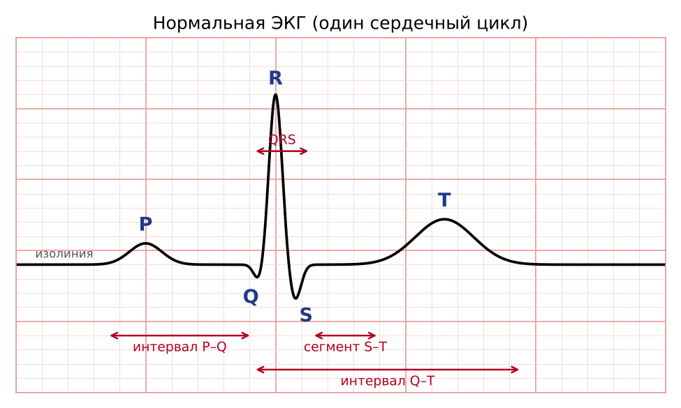
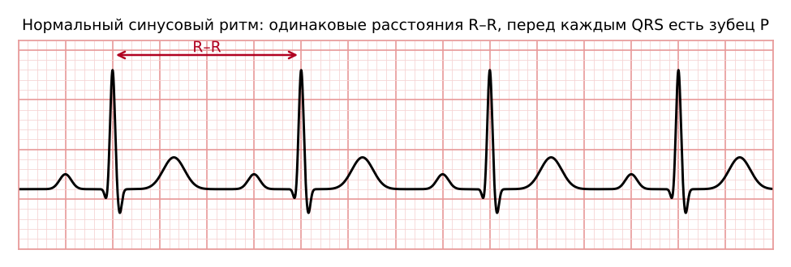
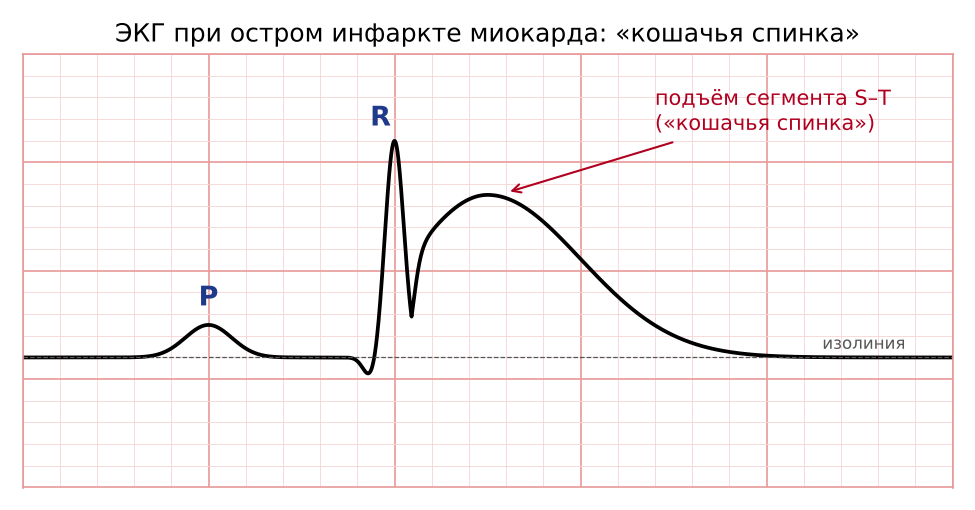
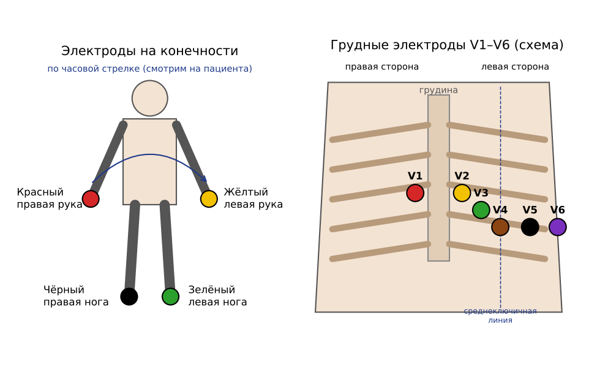

# Домашнее задание по педиатрии

**Тема:** Болезни сердца и органов кровообращения.
**Что задала преподаватель (по записи занятия):**

1. Знать и уметь **нарисовать нормальную ЭКГ**, объяснить каждый зубец.
2. Знать картину **«кошачья спинка»** на ЭКГ при инфаркте.
3. Знать **наложение электродов** ЭКГ (конечности и грудные).
4. Записать в тетрадь манипуляцию **«Забор крови вакутейнером»** и **цвета крышек** пробирок.
5. Записать **внутривенное** и **внутримышечное** введение препарата.
6. Записать **подачу кислорода**.
7. Повторить вопросы, которые она задавала на занятии.

> **Важно.** Запись занятия плохого качества, список заданий — моя реконструкция. Рисунки ЭКГ и алгоритмы манипуляций составлены по общим правилам сестринского дела, а не по лекции. В вашем колледже есть свои **чек-листы** — шаги могут немного отличаться. Сверьте с чек-листом преподавателя.

---

## 1. Нормальная ЭКГ

**ЭКГ (электрокардиограмма)** — запись электрической работы сердца.

### Что означает каждый элемент

| Элемент | Что означает | Норма |
|---|---|---|
| **Зубец P** | Возбуждение (сокращение) **предсердий** | до 0,10 с; положительный |
| **Интервал P–Q** | Импульс идёт от предсердий к желудочкам | 0,12–0,20 с |
| **Зубец Q** | Начало возбуждения желудочков (перегородка) | маленький, до 0,03 с |
| **Зубец R** | Возбуждение основной массы **желудочков** | самый высокий зубец |
| **Зубец S** | Конец возбуждения желудочков | отрицательный, после R |
| **Комплекс QRS** | Всё возбуждение (сокращение) **желудочков** | 0,06–0,10 с |
| **Сегмент S–T** | Желудочки полностью возбуждены | на изолинии |
| **Зубец T** | Восстановление (расслабление) желудочков | положительный |
| **Интервал Q–T** | Вся электрическая систола желудочков | 0,35–0,44 с |
| **Интервал R–R** | Один сердечный цикл. По нему считают ЧСС | одинаковые расстояния |

**Изолиния** — ровная линия между зубцами (сердце «отдыхает»).

### Как нарисовать ЭКГ по шагам

1. Нарисовать ровную линию — **изолинию**.
2. Маленький круглый бугорок вверх — **P**.
3. Короткий ровный участок на изолинии.
4. Маленький зубец вниз — **Q**.
5. Высокий острый зубец вверх — **R**.
6. Острый зубец вниз, ниже изолинии — **S**.
7. Короткий ровный участок на изолинии — **сегмент S–T**.
8. Широкий круглый бугорок вверх, выше чем P — **T**.
9. Снова изолиния. Потом всё повторяется.

**Как запомнить порядок:** буквы идут по алфавиту — **P, Q, R, S, T**.

### Нормальный ритм

**Признаки нормального (синусового) ритма:**
- перед каждым комплексом QRS есть зубец **P**;
- расстояния **R–R одинаковые**;
- ЧСС соответствует возрасту (взрослые 60–90, новорождённый 120–140, ребёнок 5 лет — около 100 в минуту).

### Бумага ЭКГ

| Скорость ленты | 1 маленькая клетка (1 мм) | 1 большая клетка (5 мм) |
|---|---|---|
| 50 мм/с | 0,02 с | 0,1 с |
| 25 мм/с | 0,04 с | 0,2 с |

---

## 2. ЭКГ при инфаркте миокарда — «кошачья спинка»

- **Инфаркт миокарда** — гибель участка сердечной мышцы, потому что закрылась коронарная артерия.
- На ЭКГ в острый период **сегмент S–T поднимается высоко над изолинией** и сливается с зубцом T.
- Получается дуга, похожая на выгнутую спину кошки. Это и есть **«кошачья спинка»**.
- Позже появляется глубокий и широкий **патологический зубец Q**.

**«Золотое время»:** первые часы после начала инфаркта — самые важные. Преподаватель говорила про **первые 2 часа**. Чем раньше пациент попадёт в сосудистый центр, тем больше сердечной мышцы можно спасти.

**Что делает медсестра, если видит такую ЭКГ:** сразу вызвать врача, уложить пациента, обеспечить покой и доступ воздуха, измерить АД и пульс, не оставлять пациента одного.

---

## 3. Наложение электродов ЭКГ

### Электроды на конечности

Правило: «**К**аждая **Ж**енщина **З**лее **Ч**ёрта». Начинаем с **правой руки** и идём по кругу.

| Слово | Цвет | Куда |
|---|---|---|
| **К**аждая | **Красный** | правая рука |
| **Ж**енщина | **Жёлтый** | левая рука |
| **З**лее | **Зелёный** | левая нога |
| **Ч**ёрта | **Чёрный** | правая нога (заземление) |

Руки — на внутреннюю поверхность предплечья, выше запястья. Ноги — на внутреннюю поверхность голени, выше лодыжки.

### Грудные электроды (6 штук)

Первые три цвета — как **светофор**: красный, жёлтый, зелёный.

| Электрод | Цвет | Куда |
|---|---|---|
| **V1** | красный | 4-е межреберье **справа** от грудины |
| **V2** | жёлтый | 4-е межреберье **слева** от грудины |
| **V3** | зелёный | посередине между V2 и V4 |
| **V4** | коричневый | 5-е межреберье по левой **среднеключичной** линии |
| **V5** | чёрный | левая **передняя подмышечная** линия, на уровне V4 |
| **V6** | фиолетовый | левая **средняя подмышечная** линия, на уровне V4 |

### Алгоритм снятия ЭКГ (кратко)

1. Представиться, идентифицировать пациента, объяснить процедуру, получить согласие (у ребёнка — согласие родителей).
2. Вымыть руки.
3. Уложить пациента на спину. Освободить от одежды грудь, запястья и голени.
4. Обработать кожу в местах электродов, нанести гель (или положить влажные салфетки).
5. Наложить электроды на конечности: красный, жёлтый, зелёный, чёрный.
6. Наложить 6 грудных электродов.
7. Попросить пациента лежать спокойно, не разговаривать. Ребёнка успокоить, отвлечь игрушкой.
8. Включить аппарат, записать ЭКГ.
9. Снять электроды, вытереть гель.
10. Подписать ленту: фамилия, возраст, дата и время.
11. Обработать электроды, вымыть руки, сделать запись в документации.

---

## 4. Забор крови из вены вакуумной системой (вакутейнер)

**Цель:** взять кровь из вены для анализа.

**Оснащение:** игла двусторонняя, держатель, вакуумные пробирки, жгут, подушечка, спиртовые салфетки, стерильные салфетки, пластырь, перчатки, лоток, штатив для пробирок, ёмкости для отходов классов А и Б, контейнер для игл, направление.

### Алгоритм

**Подготовка:**
1. Представиться. Идентифицировать пациента (фамилия, имя, возраст). Сверить с направлением.
2. Объяснить процедуру, получить согласие.
3. Подписать (промаркировать) пробирки.
4. Вымыть руки гигиеническим способом, надеть перчатки.
5. Собрать систему: вкрутить иглу в держатель.
6. Усадить или уложить пациента. Под локоть положить подушечку.

**Выполнение:**
7. Наложить жгут на среднюю треть плеча через салфетку или одежду. Пульс на лучевой артерии должен сохраняться.
8. Попросить сжать кулак. Найти вену.
9. Обработать место пункции спиртовой салфеткой **дважды**. Подождать, пока кожа высохнет.
10. Снять колпачок с иглы. Натянуть кожу, ввести иглу в вену срезом вверх под углом 15–30°.
11. Вставить пробирку в держатель до упора. Кровь пойдёт в пробирку сама.
12. **Как только кровь пошла — снять жгут.** Попросить разжать кулак. (Жгут держат не больше 1 минуты.)
13. Когда кровь перестала течь, вынуть пробирку. **Аккуратно перевернуть её 5–8 раз** (не трясти!).
14. Если нужно — вставить следующую пробирку.

**Окончание:**
15. Вынуть последнюю пробирку из держателя. Приложить сухую стерильную салфетку, извлечь иглу.
16. Попросить прижать салфетку на 5–7 минут. Руку в локте **не сгибать**. Наложить пластырь.
17. Иглу сбросить в непрокалываемый контейнер (класс Б).
18. Поставить пробирки в штатив, отправить в лабораторию с направлением.
19. Снять перчатки, сбросить в отходы класса Б. Вымыть руки.
20. Спросить пациента о самочувствии. Сделать запись в документации.

### Цвета крышек пробирок

| Цвет крышки | Что внутри | Для какого анализа |
|---|---|---|
| **Красный** | активатор свёртывания | биохимия, сыворотка |
| **Жёлтый** | гель + активатор свёртывания | биохимия, гормоны, иммунология |
| **Фиолетовый (сиреневый)** | ЭДТА | **общий анализ крови** |
| **Голубой** | цитрат натрия (1:9) | **коагулограмма** (свёртывание) |
| **Зелёный** | гепарин | биохимия плазмы |
| **Серый** | фторид натрия | **глюкоза** |
| **Чёрный** | цитрат натрия (1:4) | **СОЭ** |

**Порядок взятия пробирок:** голубая → красная или жёлтая → зелёная → фиолетовая → серая.

> У разных производителей цвета могут немного отличаться. Проверьте по таблице вашего колледжа.

---

## 5. Внутривенное введение препарата (струйно)

**Оснащение:** шприц 10–20 мл, две иглы, ампула с лекарством, растворитель, жгут, подушечка, спиртовые салфетки (не меньше 4), стерильные салфетки, пластырь, лоток, перчатки, ёмкости для отходов, контейнер для игл, противошоковая аптечка.

### Алгоритм

**Подготовка:**
1. Представиться. Идентифицировать пациента. Сверить назначение врача.
2. Объяснить процедуру, получить согласие. **Спросить про аллергию.**
3. Проверить лекарство: **название, дозу, срок годности**, целостность ампулы, внешний вид раствора.
4. Вымыть руки, надеть перчатки.
5. Обработать шейку ампулы спиртовой салфеткой, вскрыть.
6. Набрать лекарство в шприц (и растворитель, если нужно). **Сменить иглу.** Выпустить воздух, не снимая колпачок.
7. Положить шприц в стерильный лоток.
8. Уложить или усадить пациента. Под локоть — подушечку.

**Выполнение:**
9. Наложить жгут на среднюю треть плеча (через салфетку). Попросить сжать кулак.
10. Обработать место инъекции спиртовой салфеткой **дважды** (сначала широко, потом только место пункции). Дать высохнуть.
11. Натянуть кожу, зафиксировать вену. Ввести иглу срезом вверх под углом **10–15°**, почти параллельно коже, на ⅓ длины.
12. Потянуть поршень на себя. **В шприце появилась кровь — игла в вене.**
13. **Снять жгут.** Попросить разжать кулак. Ещё раз проверить, что игла в вене.
14. Вводить лекарство **медленно**. Следить за самочувствием пациента.
15. Оставить в шприце 0,5–1 мл раствора (чтобы не ввести пузырьки воздуха).

**Окончание:**
16. Приложить салфетку, извлечь иглу. Прижать на 5–7 минут (или наложить давящую повязку).
17. Иглу — в контейнер, шприц и салфетки — в отходы класса Б.
18. Снять перчатки, вымыть руки.
19. Спросить о самочувствии. Сделать запись в документации.

**❌ Ошибки:** не снять жгут перед введением; ввести лекарство мимо вены; вводить быстро; не спросить про аллергию.

**Особенности у детей:** ребёнка фиксирует помощник; используют тонкие иглы или иглы-«бабочки»; у маленьких детей — вены кисти, стопы, головы.

---

## 6. Внутримышечное введение препарата

**Оснащение:** шприц 2–5 мл, две иглы, ампула с лекарством, спиртовые салфетки (3 штуки), лоток, перчатки, ёмкости для отходов, контейнер для игл, противошоковая аптечка.

**Места инъекции:**
- **верхний наружный квадрант ягодицы**;
- **средняя треть переднебоковой поверхности бедра** (у маленьких детей — основное место);
- дельтовидная мышца плеча.

### Алгоритм

**Подготовка:**
1. Представиться. Идентифицировать пациента. Сверить назначение врача.
2. Объяснить процедуру, получить согласие. **Спросить про аллергию.**
3. Проверить лекарство: название, дозу, срок годности, целостность ампулы.
4. Вымыть руки, надеть перчатки.
5. Набрать лекарство в шприц. **Сменить иглу.** Выпустить воздух.
6. Уложить пациента на живот или на бок.

**Выполнение:**
7. Осмотреть и пропальпировать место инъекции (нет ли уплотнений, боли).
8. Обработать кожу спиртовой салфеткой **дважды**: сначала большую зону, потом место инъекции. Дать высохнуть.
9. Левой рукой **растянуть** кожу (у детей и худых пациентов — собрать в **складку**).
10. Ввести иглу быстрым движением под углом **90°** на ⅔ длины.
11. Потянуть поршень на себя. **Крови в шприце быть не должно.** (Если кровь есть — игла в сосуде, изменить положение иглы.)
12. **Медленно** ввести лекарство.
13. Приложить спиртовую салфетку, быстро извлечь иглу. Слегка прижать, **не массировать сильно**.

**Окончание:**
14. Иглу — в контейнер, шприц и салфетки — в отходы класса Б.
15. Снять перчатки, вымыть руки.
16. Спросить о самочувствии. Сделать запись в документации.

**❌ Ошибки:** укол не в верхний наружный квадрант (можно повредить седалищный нерв); не проверить, попала ли игла в сосуд; вводить масляный раствор холодным.

---

## 7. Подача увлажнённого кислорода (оксигенотерапия)

**Цель:** уменьшить гипоксию (нехватку кислорода). Это **основа помощи при одышечно-цианотическом кризе**.

**Оснащение:** источник кислорода с дозиметром (редуктором), **аппарат Боброва** (увлажнитель) со стерильной водой, стерильные **носовые канюли** или **маска** по возрасту, соединительные трубки, перчатки, лоток, салфетки, ёмкости для отходов.

### Алгоритм (через носовые канюли)

**Подготовка:**
1. Представиться. Идентифицировать пациента. Сверить назначение врача.
2. Объяснить процедуру пациенту или родителям, получить согласие.
3. Вымыть руки, надеть перчатки.
4. Подготовить аппарат Боброва: налить стерильную воду на ⅔ объёма.
5. Проверить, что система работает и кислород идёт через воду (видны пузырьки).
6. Придать пациенту положение с **возвышенным головным концом**.
7. Убедиться, что носовые ходы свободны. Если нужно — очистить нос.

**Выполнение:**
8. Соединить канюли с увлажнителем и источником кислорода.
9. Ввести канюли в носовые ходы. Закрепить трубки за ушами и под подбородком. Трубка не должна давить.
10. Открыть вентиль, установить **скорость подачи по назначению врача**.
11. Наблюдать за пациентом: **цвет кожи, ЧДД, пульс**, поведение, сатурация (если есть пульсоксиметр).
12. Подавать кислород столько времени, сколько назначил врач.

**Окончание:**
13. Закрыть вентиль. Снять канюли.
14. Канюли — в отходы класса Б (одноразовые) или на дезинфекцию.
15. Снять перчатки, вымыть руки.
16. Спросить о самочувствии, оценить состояние. Сделать запись в документации.

**Правила безопасности:**
- кислород подают **только увлажнённым** — сухой кислород сушит и повреждает слизистую;
- рядом **нельзя** курить, пользоваться открытым огнём;
- **нельзя** смазывать руки и оборудование жиром, маслом, кремом (опасность взрыва);
- каждые 30–60 минут менять положение канюль, следить за кожей носа и ушей;
- у маленьких детей кислород можно подавать через маску или в кислородной палатке.

---

## 8. Вопросы преподавателя на занятии — короткие ответы

| Вопрос | Ответ |
|---|---|
| Когда закладывается сердце? | На 2-й неделе внутриутробной жизни |
| Когда начинаются сокращения? | На 6–8-й неделе (видно на УЗИ) |
| Когда можно услышать сердцебиение плода стетоскопом? | С 18–20-й недели |
| Когда формируются ВПС? | На 2–8-й неделе беременности |
| Что первое видно у ребёнка с ВПС? | Одышка, цианоз, вялость, плохая прибавка в весе |
| ЧДД у новорождённого? | 40–60 в минуту |
| ЧСС у новорождённого? | 120–140 в минуту |
| Как считать пульс у маленьких детей? | Ровно 60 секунд |
| Как считать пульс у старших детей? | 15 секунд и умножить на 4 |
| АД у новорождённого? | 70–75 мм рт. ст., диастолическое ½–⅔ от систолического |
| Открытое овальное окно — это болезнь? | Нет. Наблюдают по УЗИ до 3 и до 5 лет, без профессионального спорта |
| Как часто бывает дополнительная хорда? | У каждого второго ребёнка, может давать шум |
| Как накладывать электроды на конечности? | Красный — правая рука, жёлтый — левая рука, зелёный — левая нога, чёрный — правая нога |
| Сколько грудных электродов? | Шесть (V1–V6) |
| Что такое «кошачья спинка»? | Подъём сегмента S–T на ЭКГ при остром инфаркте миокарда |
