# Презентация «Кроветворение у детей. Анемии. Гемобластозы» — по слайдам

**Как пользоваться.** Преподаватель идёт по слайдам. Здесь каждый слайд: маленькая картинка, **что на нём**, **объяснение своими словами** и **слова, которые нужно понимать**.

- Если объяснения нет ни в презентации, ни в аннотации, ни в лекции № 6, оно помечено **(доп.)** — это я добавил, чтобы было понятно.
- На слайдах с фото преподаватель часто задаёт вопрос «что вы видите?». Для них есть готовый ответ.
- В конце — **словарь** всех трудных слов.

---

# Часть 1. Кровь ребёнка (слайды 1–9)

### Слайд 1. Титульный

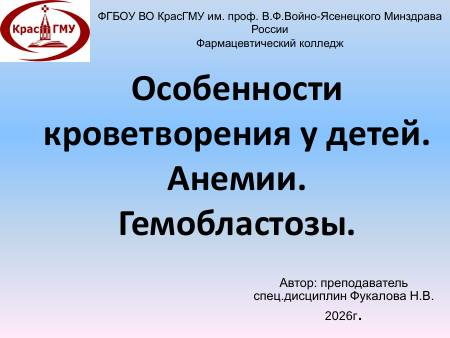{width=6cm}

Тема: **особенности кроветворения у детей, анемии, гемобластозы**.

- **Кроветворение (гемопоэз)** — образование клеток крови.
- **Гемобластозы** — опухоли (рак) кроветворной ткани. Главный пример — **лейкоз**.

### Слайд 2. План лекции

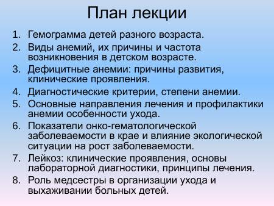{width=6cm}

8 пунктов. Это и есть **план ответа** на экзамене: гемограмма → виды анемий → дефицитные анемии → диагностика и степени → лечение и профилактика → статистика в крае → лейкоз → роль медсестры.

### Слайд 3. Кровь здорового ребёнка 10 лет (фото мазка)

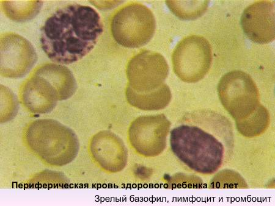{width=6cm}

**Что видим:** много **эритроцитов** (круглые светлые клетки без ядра), **зрелый базофил** (вверху слева, тёмные крупные гранулы), **лимфоцит** (внизу, большое круглое ядро), **тромбоцит** (маленькая точка).

**Если спросят «что вы видите?»:** «Нормальные эритроциты одинакового размера и формы, базофил, лимфоцит и тромбоцит».

- **Мазок крови** — капля крови, размазанная на стекле и окрашенная, смотрят в микроскоп. **(доп.)**
- **Базофил** — лейкоцит, участвует в **аллергических** реакциях. **(доп.)**
- **Лимфоцит** — лейкоцит **иммунитета** (антитела, защита от вирусов). **(доп.)**

### Слайд 4. Гемограмма у детей разного возраста

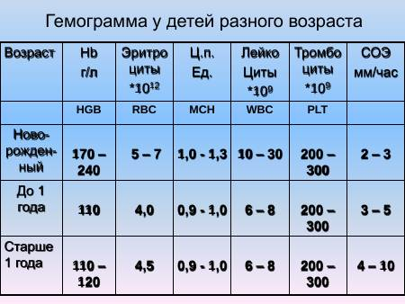{width=6cm}

**Гемограмма** = общий анализ крови (ОАК). Таблица норм по возрасту.

| Возраст | Hb, г/л | Эритроциты ·10¹² | ЦП | Лейкоциты ·10⁹ | Тромбоциты ·10⁹ | СОЭ мм/ч |
|---|---|---|---|---|---|---|
| Новорождённый | 170–240 | 5–7 | 1,0–1,3 | 10–30 | 200–300 | 2–3 |
| До 1 года | 110 | 4,0 | 0,9–1,0 | 6–8 | 200–300 | 3–5 |
| Старше 1 года | 110–120 | 4,5 | 0,9–1,0 | 6–8 | 200–300 | 4–10 |

**Сокращения на слайде (английские, как в анализаторе)** **(доп.)**:

| Сокр. | Полностью | По-русски |
|---|---|---|
| **HGB** | hemoglobin | гемоглобин |
| **RBC** | red blood cells | эритроциты («красные клетки») |
| **MCH** | mean corpuscular hemoglobin | среднее содержание Hb в одном эритроците (≈ цветовой показатель) |
| **WBC** | white blood cells | лейкоциты («белые клетки») |
| **PLT** | platelets | тромбоциты |

- **Цветовой показатель (ЦП)** — сколько гемоглобина в одном эритроците. Норма около 1. Мало → эритроциты бледные (**гипохромия**). **(доп.)**
- **СОЭ (скорость оседания эритроцитов)** — как быстро эритроциты опускаются на дно пробирки за 1 час. Растёт при **воспалении**. **(доп.)**
- **·10¹²/л** — «триллионов в литре»; **·10⁹/л** — «миллиардов в литре». **(доп.)**

**Почему у новорождённого так много Hb?** В утробе мало кислорода, организм делает много эритроцитов и **фетальный гемоглобин** (60–80 %). После рождения за 3 месяца его заменяет гемоглобин взрослых (из лекции № 6).

### Слайд 5. Лейкоцитарная формула — определение

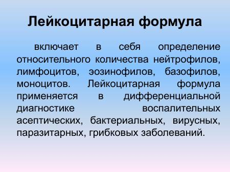{width=6cm}

**Лейкоцитарная формула** — **процент** каждого вида лейкоцитов: нейтрофилы, лимфоциты, эозинофилы, базофилы, моноциты.
**Зачем:** отличить воспаление **асептическое, бактериальное, вирусное, паразитарное, грибковое**.

**Как это работает (доп.):**

| Что выросло | О чём думать |
|---|---|
| Нейтрофилы | бактериальная инфекция |
| Лимфоциты | вирусная инфекция |
| Эозинофилы | аллергия, глисты (паразиты) |
| Моноциты | хроническая инфекция, некоторые вирусы |

- **Асептическое воспаление** — воспаление **без микробов** (например, после травмы). **(доп.)**

### Слайд 6. Лейкоцитарная формула — таблица

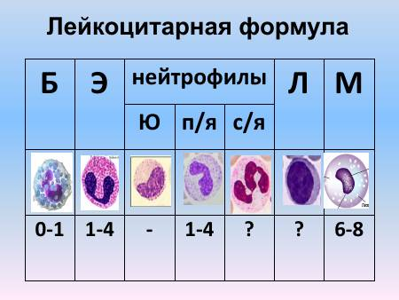{width=6cm}

| Б | Э | Ю | п/я | с/я | Л | М |
|---|---|---|---|---|---|---|
| 0–1 | 1–4 | — | 1–4 | ? | ? | 6–8 |

**Расшифровка:** Б — базофилы, Э — эозинофилы, **Ю — юные** нейтрофилы, **п/я — палочкоядерные**, **с/я — сегментоядерные**, Л — лимфоциты, М — моноциты.

- **Юные → палочкоядерные → сегментоядерные** — это нейтрофилы разного **возраста**: юный — самый молодой, ядро как боб; палочкоядерный — ядро как палочка; сегментоядерный — зрелый, ядро из 3–5 долек (сегментов). **(доп.)**
- **Почему «?» у с/я и Л:** их процент **зависит от возраста** (см. перекрёсты на слайдах 7–8). Это вопрос-ловушка преподавателя.

### Слайды 7–8. Перекрёсты лейкоцитарной формулы (графики)

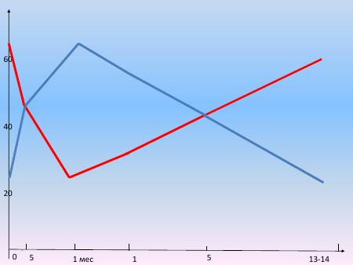{width=6cm} 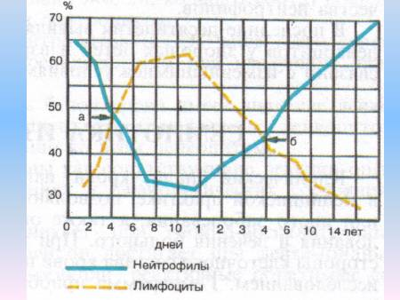{width=6cm}

**Красная / сплошная линия — нейтрофилы, синяя / пунктир — лимфоциты.**

| Возраст | Что происходит |
|---|---|
| Рождение | нейтрофилов ~65 %, лимфоцитов ~25–30 % |
| **5-й день** (стрелка «а») | **1-й перекрёст**: поровну, ~45 % |
| 1 месяц – 1 год | **лимфоцитов больше всего** (~60 %) |
| **5 лет** (стрелка «б») | **2-й перекрёст**: снова поровну |
| 14 лет | как у взрослых: нейтрофилов ~60–70 % |

**Как запомнить:** «**пять дней — пять лет**».
**Почему важно для медсестры (доп.):** у малыша много лимфоцитов — это **норма**, а не вирус.

### Слайд 9. Нормы в анализаторе

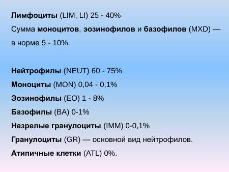{width=6cm}

| Показатель | Норма |
|---|---|
| Лимфоциты (LIM) | 25–40 % |
| **MXD** = моноциты + эозинофилы + базофилы | 5–10 % |
| Нейтрофилы (NEUT) | 60–75 % |
| Моноциты (MON) | 0,04–0,1 (так на слайде) |
| Эозинофилы (EO) | 1–8 % |
| Базофилы (BA) | 0–1 % |
| Незрелые гранулоциты (IMM) | 0–0,1 % |
| Гранулоциты (GR) | основной вид — нейтрофилы |
| Атипичные клетки (ATL) | **0 %** |

- **Гранулоциты** — лейкоциты с **зёрнами (гранулами)** внутри: нейтрофилы, эозинофилы, базофилы. **(доп.)**
- **Атипичные клетки** — «неправильные» клетки; в норме их **нет**. Если есть — подозрение на **лейкоз** или вирус. **(доп.)**
- ⚠️ Моноциты: на слайде 6 — 6–8 %, здесь — 0,04–0,1. Цифра 0,04–0,1 похожа на абсолютное число (·10⁹/л), а не процент. **(доп.)** На экзамене говорите **6–8 %**.

---

# Часть 2. Анемия (слайды 10–34)

### Слайд 10. Анемия — определение

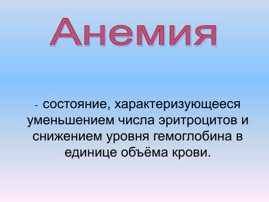{width=6cm}

**Анемия** — состояние, при котором **уменьшается число эритроцитов** и **снижается гемоглобин** в единице объёма крови.
**Своими словами:** в крови мало «носильщиков кислорода» → органы получают мало кислорода (**гипоксия**).

### Слайд 11. Виды анемий (схема)

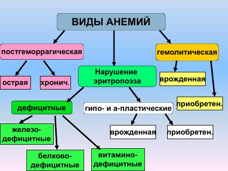{width=6cm}

| Вид | Что случилось | Подвиды |
|---|---|---|
| **Постгеморрагическая** | **потеря крови** | **острая** (сразу много, например травма) и **хроническая** (понемногу долго, например носовые кровотечения) **(доп.)** |
| **Гемолитическая** | эритроциты **разрушаются** слишком быстро | **врождённая** (наследственная) и **приобретённая** (яды, лекарства, инфекции) **(доп.)** |
| **Нарушение эритропоэза** | костный мозг **плохо делает** эритроциты | **дефицитные** (железо-, белково-, витаминодефицитные) и **гипо- / апластические** |

- **Гемолиз** — разрушение эритроцитов. **(доп.)**
- **Эритропоэз** — образование эритроцитов.
- **Гипопластическая** — костный мозг работает **мало**; **апластическая** — почти **не работает**. **(доп.)**
- **Витаминодефицитная** — не хватает **В₁₂** или **фолиевой кислоты**.

### Слайд 12. ЖДА — определение

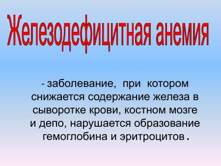{width=6cm}

**Железодефицитная анемия** — болезнь, при которой мало железа **в сыворотке крови, костном мозге и депо**, поэтому плохо образуются **гемоглобин и эритроциты**.
**Своими словами:** железо — «кирпич» для гемоглобина. Нет кирпичей → нет гемоглобина.

- **Сыворотка** — жидкая часть крови без клеток. **(доп.)**
- **Депо** — «склад» железа (печень, селезёнка, костный мозг). **(доп.)**

### Слайд 13. Распространённость ЖДА по возрасту

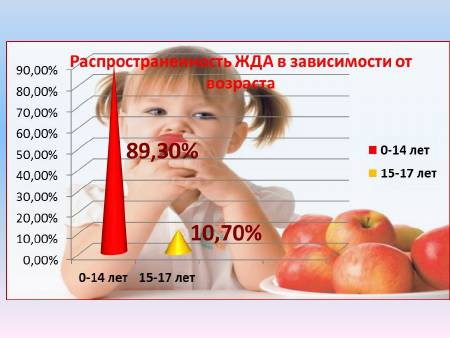{width=6cm}

Из всех случаев ЖДА у детей: **0–14 лет — 89,3 %**, **15–17 лет — 10,7 %**.
**Вывод:** ЖДА — болезнь **маленьких детей**: быстрый рост, кончаются запасы железа, неправильное питание.

### Слайд 14. Этиология (причины) ЖДА

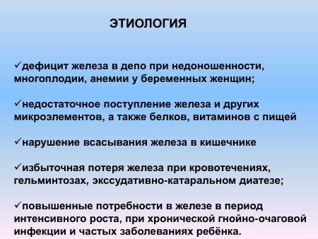{width=6cm}

5 причин — «**Депо, Питание, Всасывание, Потери, Потребность**»:
1. мало железа **в депо** — недоношенность, многоплодие, анемия у беременной;
2. мало железа **с пищей** (и микроэлементов, белков, витаминов);
3. плохое **всасывание** в кишечнике;
4. **потери** — кровотечения, гельминтозы, экссудативно-катаральный диатез;
5. большая **потребность** — быстрый рост, хроническая гнойная инфекция, частые болезни.

- **Этиология** — причины болезни. **(доп.)**
- **Многоплодие** — двойня, тройня: железа матери не хватает на всех. **(доп.)**
- **Микроэлементы** — вещества, которые нужны в очень малых количествах: железо, медь, цинк, кобальт. **(доп.)**
- **Гельминтоз** — глисты; они пьют кровь или мешают всасыванию. **(доп.)**
- **Экссудативно-катаральный диатез** — склонность ребёнка к аллергии кожи и слизистых (мокнущие корочки, опрелости); через воспалённую кожу и кишечник теряется железо. **(доп.)**
- **Гнойно-очаговая инфекция** — долгий гнойный очаг (хронический тонзиллит, отит). **(доп.)**

### Слайд 15. Клиника анемии — 4 группы симптомов

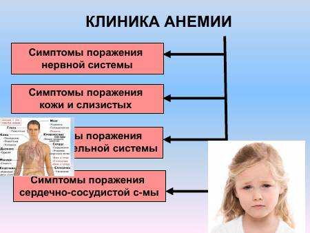{width=6cm}

Поражается: 1) **нервная система**; 2) **кожа и слизистые**; 3) **пищеварительная** система; 4) **сердечно-сосудистая** система.

### Слайд 16. Симптомы на рисунке человека

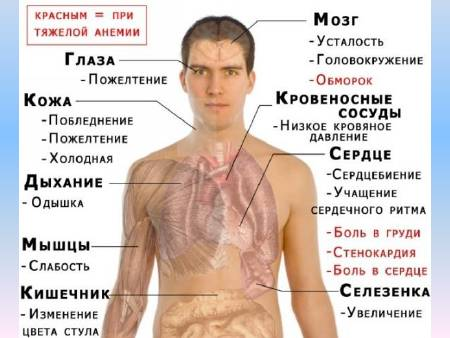{width=6cm}

**Красным = при тяжёлой анемии.**

| Орган | Симптомы |
|---|---|
| Мозг | усталость, головокружение, **обморок** |
| Глаза | пожелтение |
| Кожа | бледность, пожелтение, холодная |
| Дыхание | одышка |
| Мышцы | слабость |
| Кишечник | изменение цвета стула |
| Сосуды | низкое давление |
| Сердце | сердцебиение, частый пульс, **боль в груди, стенокардия, боль в сердце** |
| Селезёнка | увеличение |

- **Пожелтение** кожи и глаз — при **гемолитической** анемии: разрушенные эритроциты дают **билирубин** (жёлтый пигмент). **(доп.)**
- **Стенокардия** — сжимающая боль в груди: сердцу не хватает кислорода. **(доп.)**
- **Обморок** — короткая потеря сознания: мозгу не хватило кислорода. **(доп.)**
- **Изменение цвета стула** — при препаратах железа стул **чёрный** (это норма, предупредить родителей); чёрный стул без железа — признак **кровотечения** в желудке. **(доп.)**

### Слайд 17. Hb ниже 90 г/л (фото детей)

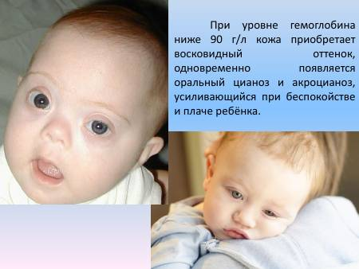{width=6cm}

При **Hb < 90 г/л**: кожа **восковидная**, **оральный цианоз** и **акроцианоз**, сильнее при плаче.

- **Восковидная кожа** — бледная, как воск, полупрозрачная. **(доп.)**
- **Оральный цианоз** — синева **вокруг рта**. **(доп.)**
- **Акроцианоз** — синие **кончики**: пальцы, нос, уши. **(доп.)**

**Если спросят «что на фото?»:** «Бледный вялый ребёнок, восковидная кожа, синева вокруг рта — признаки тяжёлой анемии».

### Слайд 18. Школьники-второгодники (график)

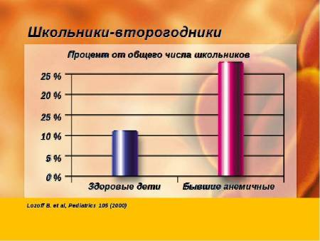{width=6cm}

Исследование (Lozoff, 2000): **дети, которые болели анемией, в 2–3 раза чаще остаются на второй год**, чем здоровые.
**Вывод:** анемия бьёт по **мозгу**: внимание, память, учёба. Поэтому её нужно лечить **рано**.

- **Второгодник** — ученик, который повторяет класс. **(доп.)**
- ⚠️ На шкале графика ошибка: «25 %» написано два раза.

### Слайд 19. Фото: врачи осматривают младенца

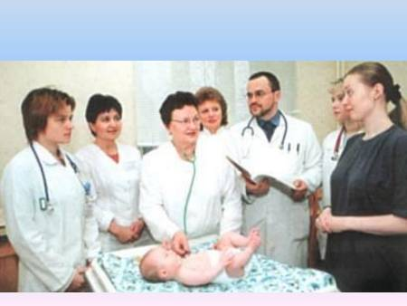{width=6cm}

Текста нет. Смысл: **диспансерное наблюдение** детей раннего возраста — осмотр педиатра + анализ крови.

### Слайд 20. Диагностические критерии (фото: забор крови из пальца)

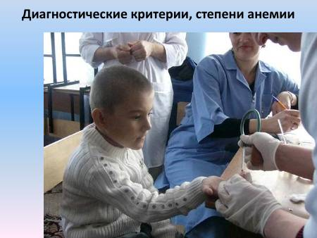{width=6cm}

Главный анализ — **общий анализ крови**. На фото медсестра берёт **капиллярную** кровь из пальца.

- **Капиллярная кровь** — из пальца (из мелких сосудов); **венозная** — из вены. **(доп.)**

### Слайд 21. Степени тяжести анемии

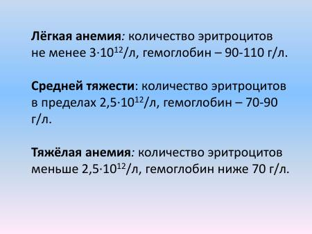{width=6cm}

| Степень | Эритроциты | Гемоглобин |
|---|---|---|
| **Лёгкая** | не менее 3·10¹²/л | **90–110 г/л** |
| **Средняя** | около 2,5·10¹²/л | **70–90 г/л** |
| **Тяжёлая** | меньше 2,5·10¹²/л | **ниже 70 г/л** |

**Как запомнить:** **110 – 90 – 70** (шаг 20).

### Слайд 22. Кровь больного анемией (мазок)

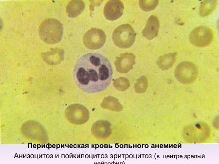{width=6cm}

**Анизоцитоз** (эритроциты разного **размера**) и **пойкилоцитоз** (разной **формы**). В центре — **зрелый нейтрофил** (ядро из нескольких долек).
Эритроциты **бледные в центре** — это **гипохромия** (мало гемоглобина). **(доп.)**

### Слайд 23. «Какие качественные изменения красной крови вы видите?»

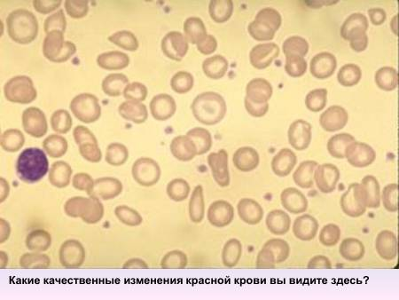{width=6cm}

Это **вопрос** преподавателя. **Готовый ответ (мой, по картинке):**
«Эритроциты **разного размера** — анизоцитоз. **Разной формы** (овальные, вытянутые, каплевидные) — пойкилоцитоз. Центр у многих **бледный** — гипохромия. Это типично для **железодефицитной анемии**. Слева — лимфоцит».

- **Качественные изменения** — изменения **вида** клеток (размер, форма, цвет), а не их количества. **(доп.)**

### Слайд 24. Алгоритм диагностики анемии

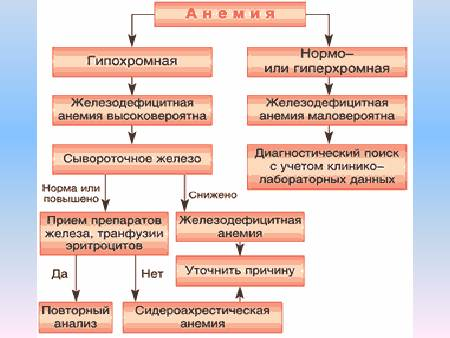{width=6cm}

```
Анемия
├── Гипохромная → ЖДА высоковероятна → сывороточное железо
│     ├── Снижено → ЖДА → уточнить причину
│     └── Норма или повышено → принимал железо? было переливание?
│            ├── Да → повторить анализ
│            └── Нет → сидероахрестическая анемия
└── Нормо- или гиперхромная → ЖДА маловероятна → искать другую причину
```

- **Сывороточное железо** — сколько железа в жидкой части крови. **Главный анализ** для подтверждения ЖДА.
- **Трансфузия эритроцитов** — **переливание** эритроцитарной массы. **(доп.)**
- **Сидероахрестическая анемия** — железа в организме **достаточно**, но костный мозг **не может его использовать** для гемоглобина. Препараты железа **не помогают**. **(доп.)**
- **Почему «повторный анализ»:** если ребёнок уже пил железо или ему переливали кровь, анализ покажет «норму» ложно. **(доп.)**

### Слайд 25. Лечение анемии у детей (фото продуктов, грудное кормление)

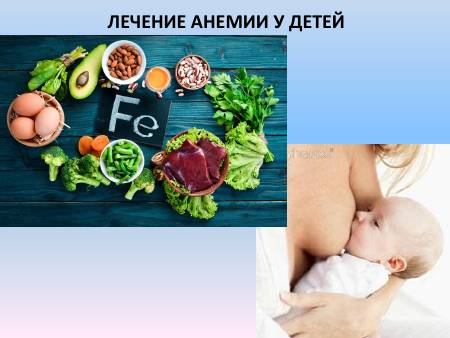{width=6cm}

Два главных «лекарства» на фото: **питание с железом** (печень, мясо, яйца, бобовые, зелень) и **грудное вскармливание**.

- Железо из **грудного молока** усваивается **лучше всего** (около 50 %), из коровьего — плохо. **(доп.)**

### Слайд 26. Источники железа (мг в 100 г)

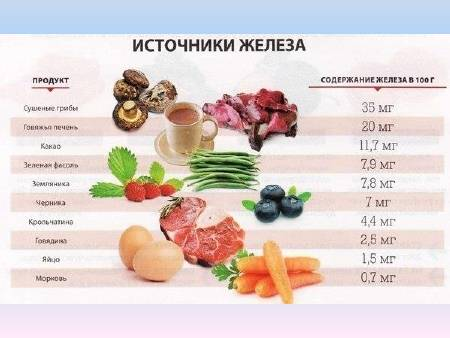{width=6cm}

Сушёные грибы 35 · **говяжья печень 20** · какао 11,7 · зелёная фасоль 7,9 · земляника 7,8 · черника 7 · крольчатина 4,4 · говядина 2,5 · яйцо 1,5 · морковь 0,7.

⚠️ **Важно (доп.):** из **мяса и печени** железо усваивается намного лучше (**гемовое** железо, 20–30 %), чем из растений (2–5 %), даже если в растении цифра больше.

### Слайд 27. Алгоритм лечения ЖДА

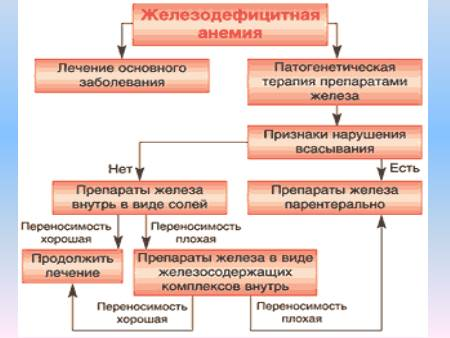{width=6cm}

```
ЖДА → 1) лечить основное заболевание
    → 2) препараты железа (патогенетическая терапия)
          Есть нарушение всасывания? 
          ├── Есть → железо ПАРЕНТЕРАЛЬНО
          └── Нет → железо ВНУТРЬ (соли)
                 ├── переносит хорошо → продолжать
                 └── плохо → железосодержащие комплексы внутрь
                        ├── хорошо → продолжать
                        └── плохо → парентерально
```

- **Патогенетическая терапия** — лечение, которое действует на **механизм** болезни (здесь: восполняет железо). **(доп.)**
- **Парентерально** — **не через рот**: уколом в мышцу или в вену. **(доп.)**
- **Соли железа** — простые соединения (сульфат железа и др.). **Комплексы** — железо, «упакованное» в большую молекулу (ГПК), мягче для желудка. **(доп.)**
- **Переносимость** — как организм реагирует на лекарство (тошнота, боль в животе, запор = плохая переносимость). **(доп.)**

### Слайд 28. Сравнение препаратов: соли Fe (II) и Fe (III)-ГПК

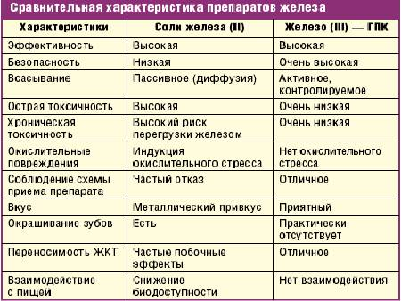{width=6cm}

| | Соли Fe (II) | Fe (III) — ГПК |
|---|---|---|
| Эффективность | высокая | высокая |
| Безопасность | низкая | очень высокая |
| Всасывание | пассивное (диффузия) | активное, контролируемое |
| Токсичность | высокая, риск перегрузки | очень низкая |
| Окислительный стресс | есть | нет |
| Вкус | металлический | приятный |
| Окрашивание зубов | есть | почти нет |
| ЖКТ | частые побочные эффекты | отличная переносимость |
| Пища | снижает всасывание | не мешает |

- **ГПК** — **гидроксид-полимальтозный комплекс**: железо, связанное с сахаром мальтозой. Примеры: **мальтофер, феррум лек**. **(доп.)**
- **Fe (II)** — двухвалентное железо, **Fe (III)** — трёхвалентное (разная химическая форма). **(доп.)**
- **Диффузия** — вещество проходит само, **без контроля** организма → можно получить **слишком много** железа. **(доп.)**
- **Окислительный стресс** — повреждение клеток свободными радикалами (агрессивными молекулами). **(доп.)**
- **Биодоступность** — какая часть лекарства реально **всасывается**. **(доп.)**
- **Соблюдение схемы приёма** (комплаенс) — пьёт ли пациент лекарство так, как назначено. Из-за плохого вкуса дети часто **отказываются**. **(доп.)**

⚠️ В лекции № 6 написано наоборот: «лучше всасывается двухвалентное». Обе мысли верны: Fe (II) всасывается **быстрее**, Fe (III)-ГПК **безопаснее**.

### Слайд 29. Препараты железа по возрасту

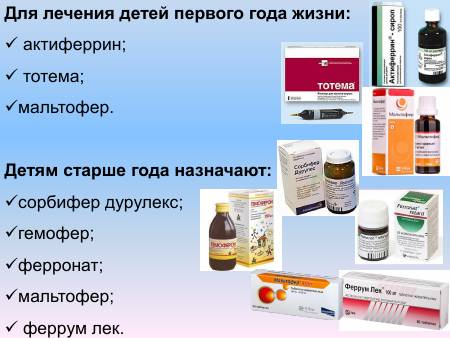{width=6cm}

| Возраст | Препараты |
|---|---|
| **До 1 года** | **актиферрин, тотема, мальтофер** |
| **Старше 1 года** | **сорбифер дурулекс, гемофер, ферронат, мальтофер, феррум лек** |

- **Сироп / капли** — для малышей (легко дозировать), **таблетки** — для старших. **(доп.)**
- **Ретард / дурулекс** — таблетка **медленного** высвобождения: меньше раздражает желудок. **(доп.)**

### Слайд 30. Фото: мальтофер (капли) и феррум лек (сироп)

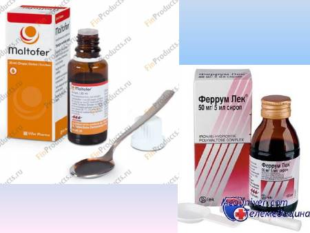{width=6cm}

Оба — **Fe (III)-ГПК**. Дают **ложечкой**. Удобны для детей.

### Слайд 31. Эффект лечения (график)

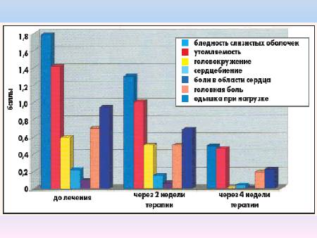{width=6cm}

Симптомы **до лечения → через 2 недели → через 4 недели**: бледность слизистых, утомляемость, головокружение, сердцебиение, боли в сердце, головная боль, одышка.
**Вывод:** через **2 недели** заметно лучше, через **4 недели** симптомов почти нет. Но **Hb восстанавливается дольше**, поэтому курс **1–3 месяца** + 1 месяц (лекция № 6).

- **Баллы** на графике — оценка силы симптома (0 = нет). **(доп.)**

### Слайд 32. Диспансерное наблюдение

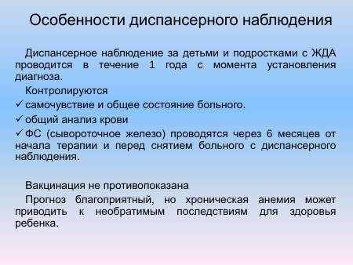{width=6cm}

- длится **1 год** после диагноза;
- контроль: **самочувствие**, **общий анализ крови**, **сывороточное железо** (через **6 месяцев** и **перед снятием с учёта**);
- **вакцинация не противопоказана**;
- прогноз хороший, **но** хроническая анемия может дать **необратимые последствия**.

- **Диспансерное наблюдение** — регулярный контроль в поликлинике по графику. **(доп.)**
- **Снятие с учёта** — ребёнок здоров, наблюдение заканчивают. **(доп.)**
- **Противопоказана** — нельзя делать. **(доп.)**

### Слайд 33. Профилактика анемии

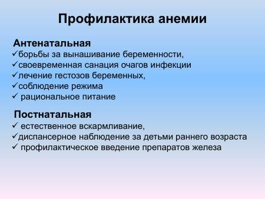{width=6cm}

| **Антенатальная** (до рождения) | **Постнатальная** (после рождения) |
|---|---|
| борьба за вынашивание беременности | **естественное вскармливание** |
| санация очагов инфекции | диспансерное наблюдение детей раннего возраста |
| лечение гестозов | профилактическое введение железа |
| режим | |
| рациональное питание | |

- **Антенатальный** — до рождения; **постнатальный** — после рождения. **(доп.)**
- **Вынашивание** — доносить беременность до срока, чтобы ребёнок **не родился недоношенным** (железо откладывается в последние 6–8 недель). **(доп.)**
- **Санация** — лечение очага инфекции (кариес, тонзиллит). **(доп.)**
- **Гестоз** — осложнение беременности: отёки, давление, белок в моче. **(доп.)**

### Слайд 34. Профилактическое железо — группа риска

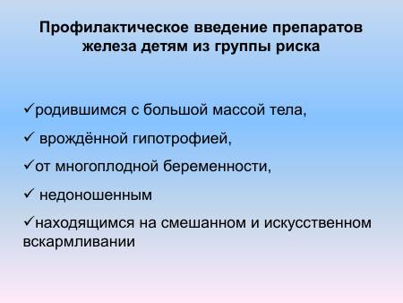{width=6cm}

Детям: **с большой массой** при рождении, с **врождённой гипотрофией**, от **многоплодной** беременности, **недоношенным**, на **смешанном и искусственном** вскармливании.

- **Почему большая масса?** Ребёнок быстро растёт → запасы железа кончаются **раньше**. **(доп.)**
- **Врождённая гипотрофия** — ребёнок родился с **малым весом** для своего срока. **(доп.)**
- **Смешанное вскармливание** — грудь + смесь; **искусственное** — только смесь. **(доп.)**

---

# Часть 3. Гемобластозы и лейкоз (слайды 35–47)

### Слайд 35. Онкогематология в Красноярском крае (2024–2025)

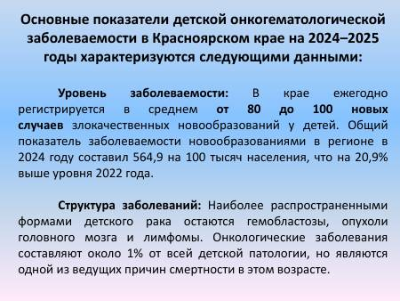{width=6cm}

- **80–100 новых случаев** рака у детей в год;
- общая заболеваемость новообразованиями — **564,9 на 100 тыс.** (на 20,9 % больше, чем в 2022);
- чаще всего: **гемобластозы, опухоли мозга, лимфомы**;
- рак — около **1 %** детских болезней, но одна из **главных причин смерти** детей.

- **Заболеваемость** — сколько **новых** случаев на число людей. **(доп.)**
- **Новообразование** — опухоль. **(доп.)**
- **Лимфома** — опухоль **лимфатических узлов**. **(доп.)**
- Экология (из лекции № 6): Красноярск — среди самых загрязнённых городов; 70 % — теплоэнергетика и металлургия, 30 % — транспорт.

### Слайд 36. Гемобластозы. Лейкоз — определение

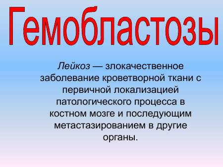{width=6cm}

**Лейкоз** — **злокачественное** заболевание **кроветворной ткани**, процесс начинается **в костном мозге**, потом **метастазирует** в другие органы.

- **Злокачественный** — опухоль растёт без контроля, разрушает ткани, распространяется. **(доп.)**
- **Метастазирование** — опухолевые клетки переходят в другие органы. **(доп.)**
- **Первичная локализация** — место, где болезнь **началась**. **(доп.)**
- Слово «лейкоз» = «белая кровь»: в крови много неправильных белых клеток. **(доп.)**

### Слайд 37. Факторы риска

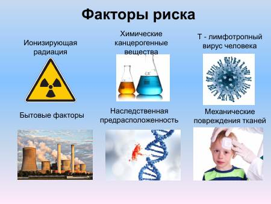{width=6cm}

**Ионизирующая радиация**, **химические канцерогены**, **Т-лимфотропный вирус человека**, **бытовые факторы** (на фото — заводы, ТЭЦ), **наследственность**, **механические повреждения** тканей.

- **Ионизирующая радиация** — облучение (рентген в больших дозах, авария на АЭС). **(доп.)**
- **Канцероген** — вещество, которое вызывает рак (бензол, некоторые краски, дым). **(доп.)**
- **Т-лимфотропный вирус (HTLV)** — вирус, который поражает Т-лимфоциты и может вызвать лейкоз. **(доп.)**
- **Наследственная предрасположенность** — болезнь чаще бывает в семье; например, у детей с **синдромом Дауна** лейкоз бывает чаще. **(доп.)**
- **Фактор риска** — то, что **повышает шанс** болезни, но не обязательно её вызывает. **(доп.)**

### Слайд 38. Схема кроветворения

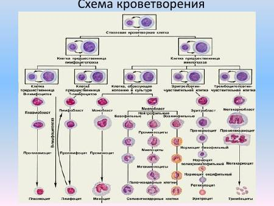{width=6cm}

**Своими словами (доп.):** все клетки крови рождаются из одной **стволовой кроветворной клетки**. Она делится на две линии:
- **лимфоидная** → **лимфоциты** (В и Т) и плазмоциты;
- **миелоидная** → **эритроциты**, **тромбоциты**, **гранулоциты** (нейтрофилы, эозинофилы, базофилы), **моноциты**.

Каждая клетка проходит путь от **бласта** (самая молодая) до **зрелой** клетки: например, **миелобласт → промиелоцит → миелоцит → метамиелоцит → палочкоядерный → сегментоядерный**; **эритробласт → нормоцит → ретикулоцит → эритроцит**; **мегакариобласт → мегакариоцит → тромбоциты**.

**Связь с лейкозом:** при лейкозе клетка **застревает на стадии бласта** и бесконечно делится. Если застрял **лимфобласт** → лимфобластный лейкоз; **миелобласт** → миелобластный.

- **Стволовая клетка** — «мать» всех клеток крови. **(доп.)**
- **Бласт** — самая молодая, незрелая клетка.
- **Ретикулоцит** — молодой эритроцит (из лекции № 6).

### Слайд 39. Лейкоз — симптомы (рисунок)

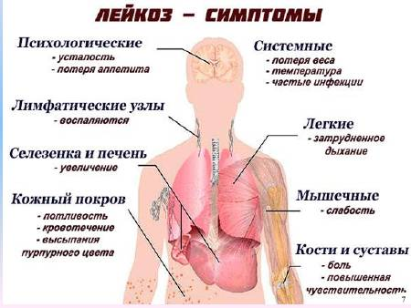{width=6cm}

| Где | Симптомы |
|---|---|
| Психологические | усталость, потеря аппетита |
| Системные | **потеря веса, температура, частые инфекции** |
| Лимфоузлы | воспаляются (увеличиваются) |
| Лёгкие | затруднённое дыхание |
| Селезёнка и печень | **увеличение** |
| Мышцы | слабость |
| Кожа | потливость, **кровотечения**, сыпь **пурпурного** цвета |
| Кости и суставы | **боль**, повышенная чувствительность |

**Почему так (доп.):**
- **частые инфекции** — нормальных лейкоцитов мало, бласты не защищают;
- **кровотечения и сыпь** — мало **тромбоцитов**;
- **бледность, слабость** — мало **эритроцитов**;
- **боль в костях** — костный мозг «распирают» бласты;
- **большие печень, селезёнка, лимфоузлы** — туда переселились бласты.

- **Пурпура** — мелкие багровые кровоизлияния в кожу. **(доп.)**

### Слайд 40. Фото больных детей

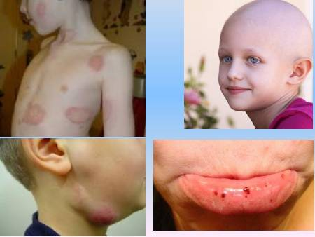{width=6cm}

**Если спросят «что вы видите?»:**
1. **Пятна на коже** — кровоизлияния / лейкемические инфильтраты кожи.
2. **Ребёнок без волос** — **алопеция** после **химиотерапии**.
3. **Увеличенный лимфоузел на шее**.
4. **Кровоизлияния на губе** — геморрагический синдром.

- **Алопеция** — выпадение волос. Волосы **вырастут** после окончания химии. **(доп.)**
- **Лейкемический инфильтрат** — скопление опухолевых клеток в органе.

### Слайд 41. Клиника в разгаре — 4 синдрома

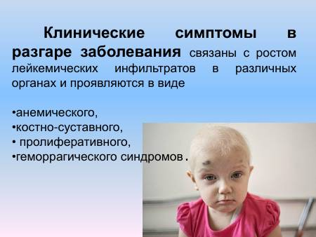{width=6cm}

Симптомы связаны с **ростом лейкемических инфильтратов** в органах. Синдромы: **анемический, костно-суставной, пролиферативный, геморрагический**.

| Синдром | Простыми словами |
|---|---|
| Анемический | мало эритроцитов → бледность, слабость |
| Костно-суставной | бласты в костном мозге → боль в костях |
| Пролиферативный | **увеличение** печени, селезёнки, лимфоузлов |
| Геморрагический | мало тромбоцитов → **кровотечения, синяки** |

- **Синдром** — группа симптомов с одной причиной. **(доп.)**
- **Пролиферация** — быстрое размножение клеток. **(доп.)**
- **Геморрагический** — связанный с кровотечением. **(доп.)**
- **Разгар** — стадия, когда болезнь выражена сильнее всего. **(доп.)**
- На фото — синяк на лбу ребёнка: геморрагический синдром.

### Слайд 42. Клиническая картина (картинки)

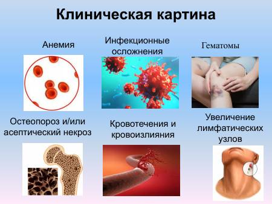{width=6cm}

**Анемия**, **инфекционные осложнения**, **гематомы**, **остеопороз и/или асептический некроз**, **кровотечения и кровоизлияния**, **увеличение лимфоузлов**.

- **Гематома** — большой синяк, кровь под кожей или в мышце. **(доп.)**
- **Кровоизлияние** — кровь вышла из сосуда в ткани. **(доп.)**
- **Остеопороз** — кость становится **хрупкой**, пористой. При лейкозе: бласты разрушают кость + гормоны (преднизолон). **(доп.)**
- **Асептический некроз** — **гибель** участка кости **без инфекции** (из-за плохого кровоснабжения, часто от гормонов). Чаще в головке бедренной кости. **(доп.)**

### Слайд 43. Диагностика

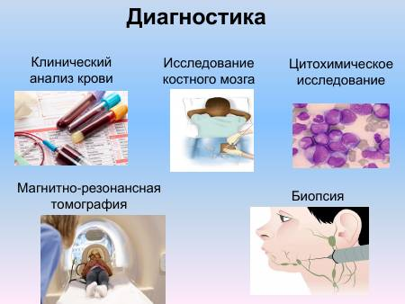{width=6cm}

1. **Клинический анализ крови**;
2. **исследование костного мозга** (пункция);
3. **цитохимическое исследование**;
4. **МРТ**;
5. **биопсия** (на рисунке — лимфоузла на шее).

- **Цитохимическое исследование** — клетки окрашивают специальными реактивами, чтобы понять **тип бластов** (лимфо- или миело-). От этого зависит лечение. **(доп.)**
- **МРТ (магнитно-резонансная томография)** — снимки органов магнитом, без облучения. Ищут поражение мозга, костей. **(доп.)**
- **Биопсия** — взять **кусочек ткани** иглой и изучить под микроскопом. **(доп.)**

### Слайд 44. Бластные клетки: здоровая кровь и лейкоз

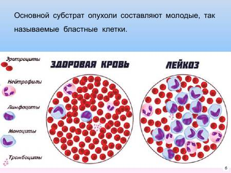{width=6cm}

**Основа опухоли — молодые бластные клетки.**
На рисунке: в здоровой крови — много эритроцитов, мало лейкоцитов; при лейкозе — **много крупных лейкоцитов (бластов)**, меньше эритроцитов и тромбоцитов.

### Слайд 45. Главные признаки острого лейкоза в крови

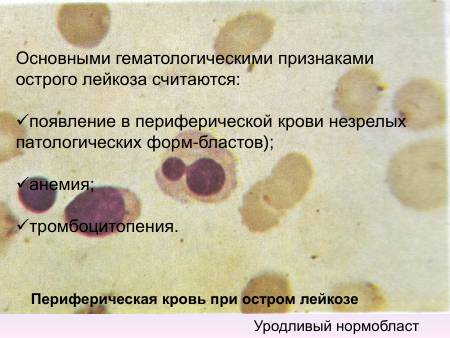{width=6cm}

**Триада:**
1. **бласты** в периферической крови;
2. **анемия**;
3. **тромбоцитопения**.

На фото — **«уродливый нормобласт»**: молодой эритроцит **с ядром** неправильной формы.

- **Периферическая кровь** — кровь в сосудах (из пальца, из вены), а не в костном мозге. **(доп.)**
- **Тромбоцитопения** — мало тромбоцитов.
- **Нормобласт** — молодой эритроцит **с ядром**; в норме в крови его **нет**, он должен остаться в костном мозге. **(доп.)**
- **Острый лейкоз** — из **бластов**, идёт быстро; **хронический** — из более зрелых клеток, идёт медленно. У детей почти всегда **острый**. **(доп.)**

### Слайд 46. Пункция костного мозга и люмбальная пункция

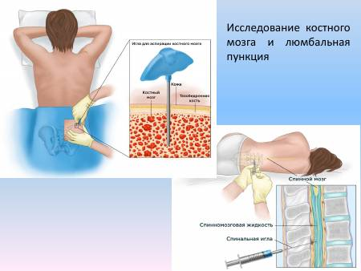{width=6cm}

**Пункция костного мозга:** игла с упором входит в **подвздошную (тазовую) кость**, берут костный мозг. Ребёнок лежит **на животе**.
**Люмбальная пункция:** иглу вводят **между позвонками поясницы**, берут **спинномозговую жидкость**. Ребёнок лежит **на боку**, колени к животу.

**Зачем (доп.):** пункция КМ — найти бласты (диагноз); люмбальная — проверить **нейролейкемию** и ввести лекарство (метотрексат).

**Роль медсестры (доп.):** подготовить стерильный набор, объяснить ребёнку и родителям, держать ребёнка в правильной позе, после пункции — давящая повязка, наблюдение; после люмбальной — **лежать** (обычно 2 часа, по назначению), следить за головной болью и рвотой.

- **Пунктат** — то, что взяли иглой.
- **Миелограмма** — анализ клеток костного мозга (в %).

### Слайд 47. Миелограмма больного лейкозом

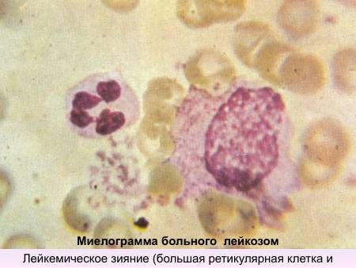{width=6cm}

**Лейкемическое зияние**: видна **большая молодая клетка** и **зрелый нейтрофил**, а **промежуточных** форм **нет** (подпись на слайде обрезана).
**Своими словами:** в норме клетки стоят «лесенкой» по возрасту. При лейкозе — только самая нижняя и самая верхняя ступеньки, **середины нет** («зияние» = пустота, дыра).

- **Ретикулярная клетка** — опорная клетка костного мозга. **(доп.)**

---

# Часть 4. Лечение лейкоза и уход (слайды 48–60)

### Слайд 48. Задачи и направления терапии

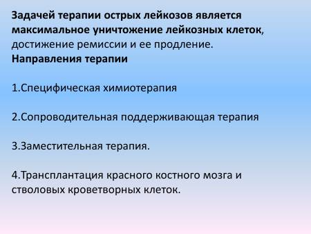{width=6cm}

**Задача:** максимально **уничтожить лейкозные клетки**, **получить ремиссию** и **продлить** её.
**4 направления:** специфическая **химиотерапия**; **сопроводительная** поддерживающая; **заместительная**; **трансплантация** красного костного мозга и стволовых клеток.

- **Ремиссия** — болезнь «затихла»: признаков нет. **Полная** — бластов в КМ < 10 % (лекция № 6). **Рецидив** — болезнь вернулась. **(доп.)**
- **Химиотерапия** — лечение **ядами для опухолевых клеток** (цитостатиками). **(доп.)**
- **Сопроводительная** — уменьшает **интоксикацию** (отравление продуктами распада опухоли, **лизис**) и побочные эффекты химии: противорвотные, антибиотики, капельницы. **(доп.)**
- **Заместительная** — **переливание** эритроцитов, тромбоцитов, когда их опасно мало. **(доп.)**
- **Трансплантация костного мозга** — пересадка здоровых стволовых клеток от донора (часто брат/сестра). **(доп.)**

### Слайд 49. Противолейкозные средства — 6 групп

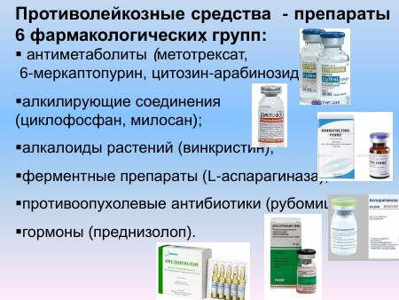{width=6cm}

| Группа | Препараты | Как действуют **(доп.)** |
|---|---|---|
| **Антиметаболиты** | метотрексат, 6-меркаптопурин, цитозин-арабинозид (цитарабин) | «подделка» веществ для ДНК → клетка не может делиться |
| **Алкилирующие** | циклофосфан, милосан | повреждают ДНК |
| **Алкалоиды растений** | винкристин (из барвинка) | останавливают деление клетки |
| **Ферменты** | L-аспарагиназа | лишают лейкозные клетки аминокислоты аспарагина |
| **Противоопухолевые антибиотики** | рубомицин | повреждают ДНК (не против микробов!) |
| **Гормоны** | преднизолон | разрушают лимфобласты |

⚠️ На слайде опечатка: «преднизолоп» → **преднизолон**.

### Слайд 50. Требования при работе с цитостатиками (1)

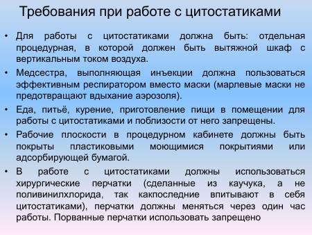{width=6cm}

- **отдельная процедурная** с **вытяжным шкафом** с вертикальным током воздуха;
- **респиратор** вместо марлевой маски (маска **не держит аэрозоль**);
- в помещении и рядом **нельзя есть, пить, курить, готовить еду**;
- рабочие поверхности — **пластиковое моющееся покрытие** или **адсорбирующая бумага**;
- **хирургические перчатки из каучука** (не ПВХ — он **впитывает** цитостатики), менять **каждый час**, порванные — нельзя.

**Почему так строго (доп.):** цитостатики убивают **любые** делящиеся клетки, в том числе клетки медсестры. Опасно вдыхать и трогать: риск для крови, кожи, **беременности**.

- **Цитостатик** — препарат, который **останавливает деление** клеток. **(доп.)**
- **Вытяжной шкаф** — шкаф со стеклом, где воздух **вытягивается** вверх и наружу. **(доп.)**
- **Аэрозоль** — мельчайшие капли лекарства в воздухе. **(доп.)**
- **Адсорбирующая бумага** — бумага, которая **впитывает** капли. **(доп.)**
- **Каучук** — латекс; **поливинилхлорид (ПВХ)** — винил. **(доп.)**

### Слайд 51. Фото: медсестра в защите

{width=6cm}

**Если спросят «что вы видите?»:** «Медсестра разводит цитостатик **в вытяжном шкафу**: **полнолицевой респиратор**, шапочка, халат с длинными рукавами, перчатки».

### Слайд 52. Требования при работе с цитостатиками (2)

{width=6cm}

- ампулу открывать **от лица**, через **стерильную марлевую салфетку**;
- при разведении жидкость вливать **медленно**, **по стенке флакона**;
- иглу во флаконе **накрыть стерильной салфеткой**;
- после разведения **сменить иглу**;
- пролитые капли **сразу вытереть**, бумажное покрытие **заменить**;
- шприцы, флаконы, салфетки, пробирки — в **баки с плотными крышками**;
- с пациентами после химии (последние **2 суток**) — работать **в перчатках**;
- руки после контакта — **вымыть** (строка обрезана на слайде; по лекции № 6: «много воды»).

**Почему 2 суток (доп.):** цитостатики выходят с **мочой, калом, рвотой, потом** — выделения опасны.

### Слайды 53–55. Уход: асептические условия (1) + фото

{width=6cm} {width=6cm}

- **влажная уборка 3 раза в сутки** + проветривание;
- **генеральная уборка не реже 1 раза в неделю** с дезинфектантом;
- удалять микробы с кожи; уход за кожей **щадящий**: **нельзя горячие ванны и душ**, **мягкие губки или фланелевые варежки** вместо мочалок;
- **бельё — каждый день**; при поражении кожи — **стерильное**.

**Фото 54** — палата (бокс) с **монитором**, **инфузоматами** (насосы для капельниц), **аппаратом ИВЛ**, **бактерицидным облучателем** на стене.
**Фото 55** — медсестра в маске и шапочке **играет** с ребёнком: **психологическая поддержка**.

- **Асептика** — работа так, чтобы микробы **не попали** к пациенту. **(доп.)**
- **Лечебно-охранительный режим** — покой, тишина, сон, мало стресса, щадящие процедуры. **(доп.)**
- **Дезинфектант** — средство, которое убивает микробы на поверхностях. **(доп.)**
- **Генеральная уборка** — полная уборка: стены, потолок, мебель, оборудование. **(доп.)**
- **Почему горячая ванна и мочалка нельзя (доп.):** кожа повреждается → **кровотечение** (мало тромбоцитов) и **ворота для инфекции** (мало лейкоцитов).
- **Бактерицидная лампа** — ультрафиолет убивает микробы в воздухе. **(доп.)**

### Слайды 56–57. Уход (2): рот, диета + фото

{width=6cm}

- **полость рта** — особый подход: обрабатывать **утром натощак** и **после каждой еды**;
- **диета высококалорийная**, белка **в 1,5 раза больше** нормы, много минералов и витаминов; **биолакт, кефир, ацидофилин**;
- показаны **эубиотики**.

Из лекции № 6: при кровоточащих дёснах **не чистить щёткой**, а **полоскать** (1–2 % натрия бикарбонат, фурацилин, шалфей, ромашка).
**Фото 57** — девушка после химии с **ноутбуком**: важно, чтобы ребёнок **учился и общался** в больнице.

- **Нетрадиционный подход** — не как обычно (не щёткой). **(доп.)**
- **Натощак** — до еды. **(доп.)**
- **Эубиотики (пробиотики)** — полезные бактерии для кишечника; после химии и антибиотиков флора погибает. **(доп.)**
- **Ацидофилин, биолакт** — кисломолочные напитки с полезными бактериями. **(доп.)**

### Слайд 58. Особенности работы медсестры с больными лейкозом

{width=6cm}

- строго соблюдать **санитарно-гигиенический и противоэпидемический режим**;
- выполнять **требования к цитостатикам**;
- знать **клинику** и **побочные действия** лекарств; уметь оказать **неотложную помощь**;
- вести **интенсивное наблюдение** при **полихимиотерапии** и **облучении**, записывать в **листы наблюдения**;
- знать правила **переливания крови**; ухаживать за **центральным венозным катетером**; помогать врачу при **костномозговой и спинномозговой пункции**, **трепанации черепа**;
- **профилактика травматизма** с родителями и детьми;
- внимательно наблюдать **после каждой манипуляции**.

- **Противоэпидемический режим** — правила против распространения инфекций (маски, изоляция, обработка рук). **(доп.)**
- **Полихимиотерапия** — химия **несколькими** препаратами сразу. **(доп.)**
- **Облучение (лучевая терапия)** — лечение радиацией. **(доп.)**
- **Лист наблюдения** — документ, куда записывают температуру, пульс, АД, диурез, состояние. **(доп.)**
- **Центральный венозный катетер (ЦВК)** — трубочка в **большой вене** (подключичной): через неё капают химию месяцами. Уход: **стерильная повязка**, промывание, следить за покраснением и температурой. **(доп.)**
- **Трепанация черепа** — операция со вскрытием костей черепа. **(доп.)**
- **Профилактика травматизма** — из-за риска **кровотечений**: мягкие игрушки, без опасных игр, мягкая зубная щётка. **(доп.)**
- **Манипуляция** — медицинская процедура (укол, пункция). **(доп.)**

### Слайд 59. 🚨 Цитостатик попал под кожу

{width=6cm}

1. **Прекратить** введение. **Не вынимая иглу**, попробовать **отсосать** лекарство.
2. Через **эту же иглу** ввести **антидот**:
   - **адриабластин, митомицин С** → **8,4 % натрия бикарбонат 5,0 мл** и **лидаза 64–128 ЕД**;
   - **эмбихин (кариолизин)** → **2,9 % натрия тиосульфат 5,0 мл**.

- **Экстравазация** — лекарство вышло **из вены** в ткани. **(доп.)**
- **Почему опасно (доп.):** многие цитостатики вызывают **некроз** (гибель) тканей вокруг вены.
- **Антидот** — **противоядие**. **(доп.)**
- **Лидаза** — фермент, который помогает лекарству **рассосаться** в тканях. **(доп.)**
- **Адриабластин** = доксорубицин; **эмбихин** — старый алкилирующий препарат. **(доп.)**
- ⚠️ Строка про бикарбонат и лидазу на слайде написана неясно; так я понимаю.

### Слайд 60. Роль медсестры в онкологии и гематологии

{width=6cm}

1. **Информировать родителей** о болезни (**вместе с врачом**).
2. Содействовать **госпитализации**.
3. **Мониторинг** жизненно важных функций.
4. Обеспечить правильный **режим**.
5. Научить родителей **оценивать боль по 10-балльной шкале**.
6. Регулярно оценивать **эффективность** терапии.
7. Помочь семье **преодолеть кризис**.
8. После выписки объяснить, **как оберегать** ребёнка.

- **Жизненно важные функции** — дыхание (ЧДД), пульс, АД, температура, сознание, диурез. **(доп.)**
- **10-балльная шкала боли** — 0 = нет боли, 10 = самая сильная. Для маленьких — шкала **лиц** (от улыбки до плача). **(доп.)**
- **Кризис** — тяжёлое состояние семьи: шок, страх, горе. Медсестра слушает, объясняет, направляет к **психологу**. **(доп.)**
- **Как оберегать после выписки (доп.):** избегать людных мест и больных людей, мыть руки, хорошо мыть и обрабатывать еду, не давать травмироваться, измерять температуру, сразу звонить врачу при температуре, кровотечении.

### Слайд 61. Литература

{width=6cm}

Учебник «Педиатрия» (Рыков, Долгополов, 2023); «Сборник манипуляций по педиатрии» (Колпикова и др., 2024); Пономарёва «Сестринский уход в педиатрии. Тестовые задания и ситуационные задачи» (2024) — там **тесты** для подготовки.

---

# Словарь трудных слов

| Слово | Простое объяснение |
|---|---|
| Агранулоцит / гранулоцит | лейкоцит без зёрен / с зёрнами |
| Адсорбирующий | впитывающий |
| Акроцианоз | синие кончики пальцев, носа, ушей |
| Алиментарный | связанный с питанием |
| Алопеция | выпадение волос |
| Анизоцитоз | эритроциты разного размера |
| Антенатальный / постнатальный | до рождения / после рождения |
| Антидот | противоядие |
| Асептика | защита пациента от попадания микробов |
| Асептический некроз | гибель ткани без инфекции |
| Атипичный | неправильный, необычный |
| Бласт | самая молодая, незрелая клетка крови |
| Биопсия | взятие кусочка ткани для анализа |
| Гемобластоз | опухоль кроветворной ткани |
| Гемолиз | разрушение эритроцитов |
| Гематома | большой синяк |
| Геморрагический | связанный с кровотечением |
| Гестоз | осложнение беременности (отёки, давление) |
| Гипоксия | нехватка кислорода в тканях |
| Гипотрофия | недостаток веса |
| Гипохромия | бледные эритроциты (мало Hb) |
| Депо | запас, «склад» |
| Диспансерное наблюдение | регулярный контроль в поликлинике |
| Злокачественный | опасный, растёт и распространяется |
| Интоксикация | отравление организма |
| Инфильтрат | скопление клеток в ткани |
| Канцероген | вещество, которое вызывает рак |
| Лизис | распад клеток |
| Метастаз | переход опухоли в другой орган |
| Миелограмма | анализ клеток костного мозга |
| Нормобласт | молодой эритроцит с ядром |
| Остеопороз | хрупкость костей |
| Парентерально | не через рот (уколом) |
| Периферическая кровь | кровь в сосудах |
| Пойкилоцитоз | эритроциты разной формы |
| Пролиферация | быстрое размножение клеток |
| Пунктат | материал, взятый иглой |
| Ремиссия / рецидив | болезнь затихла / вернулась |
| Ретикулоцит | молодой эритроцит |
| Санация | лечение очага инфекции |
| Сидероахрестическая анемия | железо есть, но не используется |
| Синдром | группа симптомов с одной причиной |
| Стволовая клетка | «мать» всех клеток крови |
| Сыворотка | жидкая часть крови без клеток |
| Тромбоцитопения | мало тромбоцитов |
| Трансфузия | переливание крови |
| Цитостатик | препарат, который останавливает деление клеток |
| Эритропоэз | образование эритроцитов |
| Эубиотик | препарат с полезными бактериями |
| Этиология | причины болезни |
