# Презентация «Геморрагические диатезы» — по слайдам

**Как пользоваться.** Преподаватель идёт по слайдам. Здесь каждый слайд: маленькая картинка, **что на нём**, **объяснение своими словами** и **трудные слова**.

- **(доп.)** — этого нет ни в презентации, ни в лекции № 16, ни в методичке (тема № 13). Я добавил, чтобы было понятно.
- На слайдах с фото часто спрашивают «что вы видите?». Для них есть **готовый ответ**.
- В конце — **ситуационные задачи из методички** (кратко), **ответы на тесты** и **словарь**.

---

# Часть 1. Что такое геморрагические диатезы (слайды 1–4)

### Слайд 1. Титульный

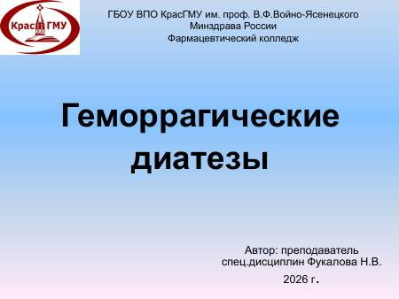{width=6cm}

Тема: **геморрагические диатезы** — болезни, при которых ребёнок **легко кровоточит**.

- **Геморрагический** — связанный с кровотечением («гемо» — кровь, «рагия» — течь). **(доп.)**
- **Диатез** — склонность, предрасположенность. **(доп.)**

### Слайд 2. План лекции

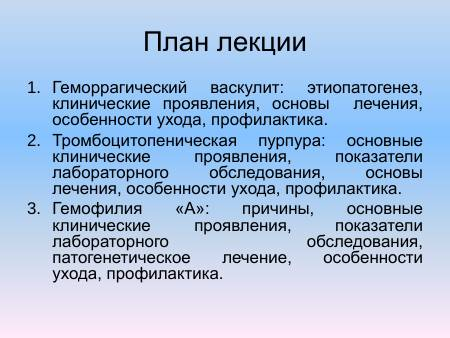{width=6cm}

Три болезни — три части лекции:

1. **Геморрагический васкулит** — причины и механизм, клиника, лечение, уход, профилактика.
2. **Тромбоцитопеническая пурпура** — клиника, анализы, лечение, уход, профилактика.
3. **Гемофилия А** — причины, клиника, анализы, лечение, уход, профилактика.

- **Этиопатогенез** = **этиология** (причины) + **патогенез** (как развивается болезнь). **(доп.)**
- **Патогенетическое лечение** — лечение, которое действует на **механизм** болезни (при гемофилии — дать недостающий фактор). **(доп.)**

### Слайд 3. Три звена гемостаза

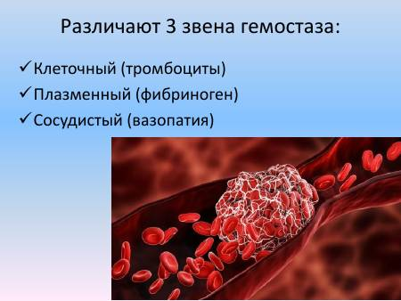{width=6cm}

- **Клеточное** — тромбоциты;
- **Плазменное** — фибриноген (и другие факторы свёртывания);
- **Сосудистое** — стенка сосуда (вазопатия).

**Своими словами (доп.):** чтобы кровотечение остановилось, нужны три вещи, как при ремонте трубы:

1. **сосуд** сжимается и держит кровь (сосудистое звено);
2. **тромбоциты** склеиваются и закрывают дырку «пробкой» (клеточное звено);
3. **белки плазмы** (факторы свёртывания) делают **сеть из фибрина**, которая укрепляет пробку (плазменное звено).

На картинке — **тромб**: эритроциты, пойманные в сеть из нитей фибрина.

**Каждая болезнь бьёт по одному звену:**

| Звено | Болезнь |
|---|---|
| Сосудистое | **геморрагический васкулит** |
| Клеточное | **тромбоцитопеническая пурпура** |
| Плазменное | **гемофилия** |

**Как запомнить:** **С**осуд — васкулит, **К**летка — тромбоцит, **П**лазма — гемофилия.

- **Гемостаз** — остановка кровотечения. **(доп.)**
- **Фибриноген** — белок плазмы; из него получается **фибрин** — нити сгустка. **(доп.)**
- **Вазопатия** — болезнь сосудов («вазо» — сосуд). **(доп.)**

### Слайд 4. Геморрагические диатезы — определение

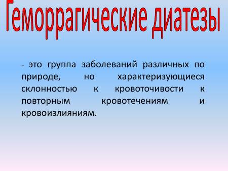{width=6cm}

**Геморрагические диатезы** — группа заболеваний, **разных по природе**, но у всех есть **склонность к кровоточивости**: **к повторным кровотечениям и кровоизлияниям**.

- **Кровотечение** — кровь выходит **наружу** (из носа, из раны). **(доп.)**
- **Кровоизлияние** — кровь уходит **в ткани** (синяк, кровь в суставе). **(доп.)**

Из методички: в мире около **5 млн** человек с первичными геморрагическими диатезами; диатезы бывают **врождённые** (наследственные, на всю жизнь) и **приобретённые**; часто болеют **весной и осенью**; провоцируют **травма, охлаждение, перегрузка, пищевая непереносимость**.

---

# Часть 2. Геморрагический васкулит (слайды 5–19)

### Слайд 5. Определение

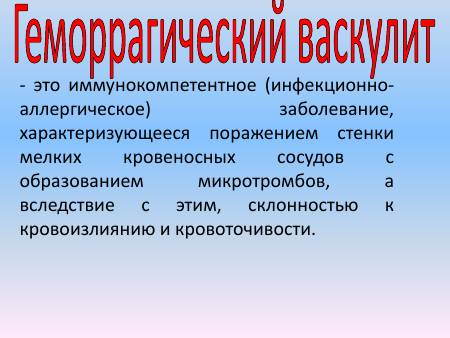{width=6cm}

**Геморрагический васкулит** — **иммунокомпетентное (инфекционно-аллергическое)** заболевание: поражается **стенка мелких сосудов**, образуются **микротромбы**, и поэтому появляется **склонность к кровоизлияниям и кровоточивости**.

- **Васкулит** — воспаление сосудов. **(доп.)**
- **Иммунокомпетентное** — здесь: болезнь, в которой участвует **иммунная система** (иммунитет атакует свои сосуды). **(доп.)**
- **Инфекционно-аллергическое** — начинается после **инфекции**, а развивается как **аллергия**. **(доп.)**
- **Микротромб** — очень маленький сгусток в мелком сосуде. **(доп.)**
- Другое название — **болезнь Шёнлейна–Геноха**. **(доп.)**

### Слайд 6. Этиология и патогенез (схема)

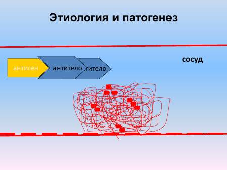{width=6cm}

**Что на схеме:** **антиген + антитело** → они соединяются в **комплекс** → комплексы садятся на **стенку сосуда** → там образуется **клубок (сгусток)**, стенка становится «дырявой» (пунктирная линия внизу).

**Причины (из лекции):** **сенсибилизация** после **вирусных и бактериальных инфекций**, **гельминтозов**, **прививок**, **лекарственной и пищевой аллергии**; важны **хронические очаги инфекции**.

**Механизм по шагам:**

1. В крови образуются **иммунные комплексы** «антиген–антитело».
2. Они **оседают на внутренней стенке** сосуда → **воспаление**.
3. Стенка становится **проницаемой**, но **не рвётся**.
4. Тромбоциты **склеиваются** на повреждённой стенке → **микротромбы**.

- **Антиген** — «чужое» вещество (микроб, лекарство, пищевой белок). **(доп.)**
- **Антитело** — белок иммунитета, который «прилипает» к антигену. **(доп.)**
- **Сенсибилизация** — организм стал **сверхчувствительным** к веществу. **(доп.)**
- **Проницаемость** — стенка пропускает кровь наружу. **(доп.)**
- **Пунктирная линия на схеме** — стенка сосуда с «дырками». **(доп.)**

### Слайд 7. ДВС-синдром

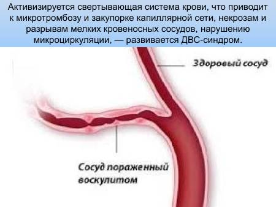{width=6cm}

Свёртывающая система **активируется** → **микротромбы** закупоривают **капилляры** → **некрозы** и **разрывы** мелких сосудов → нарушается **микроциркуляция** → **ДВС-синдром**.

На рисунке: **здоровый сосуд** ровный; **сосуд, поражённый васкулитом**, — узкий, с утолщениями и сгустками.

- **ДВС-синдром** (диссеминированное внутрисосудистое свёртывание): сначала **много мелких тромбов по всему телу**, факторы свёртывания **расходуются**, потом кровь **не сворачивается** → **сильные кровотечения**. Очень опасно. **(доп.)**
- **Микроциркуляция** — движение крови в самых мелких сосудах (капиллярах). **(доп.)**
- **Капилляры** — самые тонкие сосуды. **(доп.)**
- **Некроз** — гибель участка ткани. **(доп.)**
- ⚠️ На рисунке опечатка: «воскулитом» → **васкулитом**.

### Слайд 8. Клинические формы

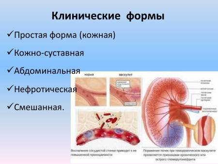{width=6cm}

1. **Простая (кожная)**;
2. **Кожно-суставная**;
3. **Абдоминальная**;
4. **Нефротическая** (почечная);
5. **Смешанная**.

**На рисунках:** слева — воспалённая стенка сосуда **пропускает** эритроциты наружу; справа — **почка**: при васкулите поражение почек похоже на **гломерулонефрит**.

- **Абдоминальная** — с болями в **животе** («абдомен» — живот). **(доп.)**
- **Нефротическая** — с поражением **почек** («нефрос» — почка). **(доп.)**
- **Гломерулонефрит** — воспаление **клубочков** почки (фильтров); в моче появляются **белок и кровь**. **(доп.)**

### Слайд 9. Фото: простая (кожная) форма

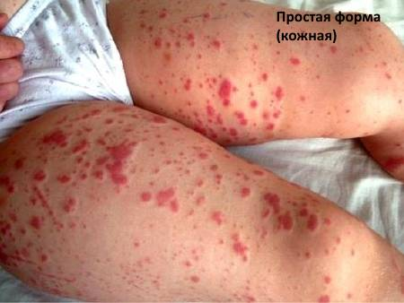{width=6cm}

**Если спросят «что вы видите?»:** «На **бёдрах** и **ногах** — **симметричная** сыпь: красные **пятна и бугорки** (папулы) разного размера, местами сливаются. Это **кожная форма геморрагического васкулита**».

**Из лекции:** сыпь **2–3 мм – 4 см**, точечная, пятнистая, **пятнисто-папулёзная**; потом становится **красно-багровой**; бывают **пузыри**, **язвы** и **некрозы**.

- **Папула** — маленький плотный бугорок над кожей. **(доп.)**
- **Пятнисто-папулёзная** — пятна + бугорки вместе. **(доп.)**
- **Чем отличается от синяка (доп.):** сыпь при васкулите **немного выпуклая**, её можно **нащупать** пальцем (**«пальпируемая пурпура»**). Сыпь при ТП — **плоская**.

### Слайд 10. Где сыпь при васкулите (рисунок)

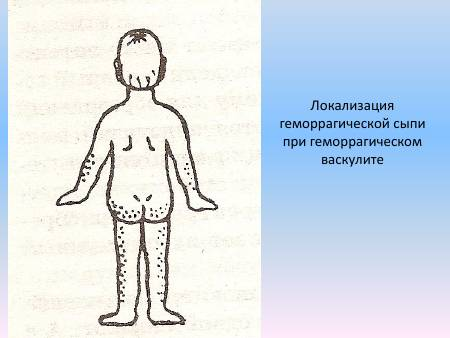{width=6cm}

Точки на рисунке: **разгибательная поверхность рук**, **ягодицы**, **ноги** (голени, бёдра). Лицо и туловище — **чистые**.

**Из лекции:** сыпь **симметричная**: разгибательная поверхность **голеней и рук**, **внутренняя поверхность бёдер**, **ягодицы**, вокруг **крупных суставов**.

- **Разгибательная поверхность** — та, что **снаружи** при сгибании (перед голени, задняя сторона предплечья). **(доп.)**
- **Почему на ногах (доп.):** в ногах **выше давление** в сосудах, когда ребёнок **стоит и ходит**. Поэтому нужен **постельный режим**.

### Слайд 11. Фото: «подсыпания» волнами

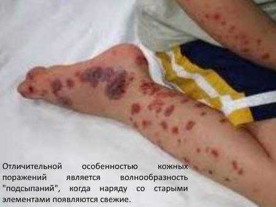{width=6cm}

**Отличительная особенность** васкулита: **волнообразные «подсыпания»** — рядом со **старыми** элементами появляются **свежие**.

**Если спросят «что вы видите?»:** «На стопе и голени — сыпь **разного возраста**: старые элементы тёмные, багровые, местами сливаются; рядом — свежие красные пятна. Это **волнообразные подсыпания** при васкулите».

**Из лекции:** через 1–2 дня сыпь **бледнеет**, проходит как синяк и оставляет **пигментацию** (коричневые пятна) надолго.

- **Пигментация** — коричневое пятно на месте сыпи. **(доп.)**

### Слайд 12. Фото: суставной синдром

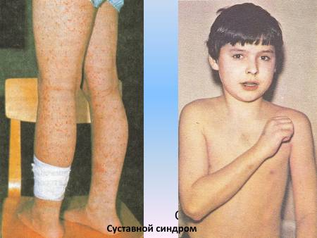{width=6cm}

**Что видим:** слева — сыпь на **ногах**, **голеностоп** перевязан (отёк, боль); справа — мальчик **держит руку**: болит **локоть**, рука в вынужденном положении.

**Из лекции:** суставной синдром чаще у детей **старше 5 лет**.

### Слайд 13. Крупные суставы

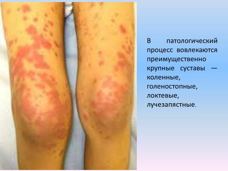{width=6cm}

Поражаются **крупные суставы**: **коленные, голеностопные, локтевые, лучезапястные**. На фото — сыпь и покраснение вокруг **коленей**.

**Из лекции:** суставы **болезненные, отёчные, гиперемированные**; движения ограничены; поражение обычно **несимметричное**; проходит **быстро** и **без деформаций**.
Ещё у детей бывает **ангионевротический отёк** — на кистях, стопах, голенях, губах, веках.

- **Гиперемия** — покраснение (прилив крови). **(доп.)**
- **Без деформаций** — сустав потом **нормальный** (в отличие от гемофилии). **(доп.)**
- **Ангионевротический отёк** — быстрый мягкий отёк кожи, как при аллергии. **(доп.)**

### Слайд 14. Фото: сыпь на голенях и стопе

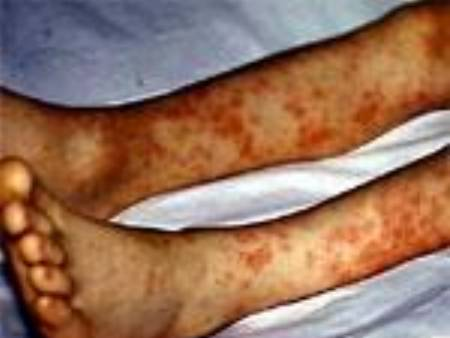{width=6cm}

Текста нет. **Ответ:** «Мелкая **симметричная** геморрагическая сыпь на **голенях и стопах**, местами сливается — геморрагический васкулит».

### Слайд 15. Фото: абдоминальный синдром

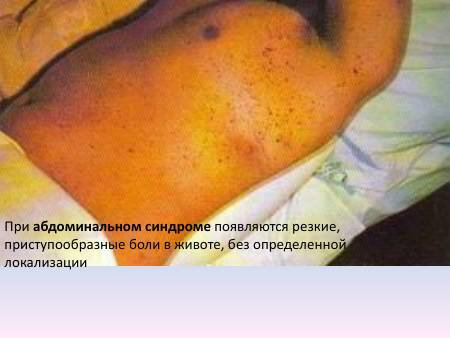{width=6cm}

При **абдоминальном синдроме** — **резкие, приступообразные** боли в животе **без точного места**.

**Из лекции:** в тяжёлых случаях — **рвота с кровью**, **тенезмы**, **кровавый или чёрный стул** со слизью (**мелена**); детей часто привозят с диагнозом **«острый живот»**.

- **Приступообразные** — боль приходит **приступами** (схватками). **(доп.)**
- **Тенезмы** — ложные болезненные позывы в туалет. **(доп.)**
- **Мелена** — **чёрный дёгтеобразный** стул: признак **кровотечения** в желудке или кишечнике. **(доп.)**
- **«Острый живот»** — сильная боль в животе, при которой может понадобиться **операция** (аппендицит и др.). **(доп.)**
- **Почему болит живот (доп.):** кровоизлияния в **стенку кишечника** → отёк, спазм. Опасные осложнения — **инвагинация** (кишка входит в кишку) и **перфорация** (дырка).

### Слайд 16. Фото: смешанная форма

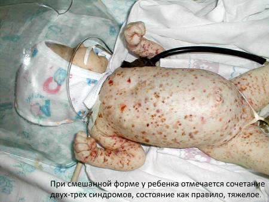{width=6cm}

При **смешанной** форме — **2–3 синдрома** сразу, состояние **тяжёлое**.

**Если спросят «что вы видите?»:** «Ребёнок в **реанимации**, на **кислороде** (кислородная палатка), с **зондом**; по всему телу **обильная геморрагическая сыпь**; живот вздут. Тяжёлая смешанная форма».

**Почечная форма (из лекции):** определяет **тяжесть и прогноз**; от небольшого белка и эритроцитов в моче до **тяжёлого поражения почек**.

### Слайд 17. Диагностика

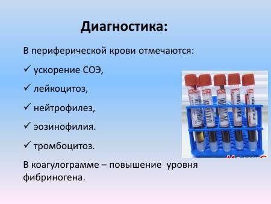{width=6cm}

**В крови:** **ускорение СОЭ**, **лейкоцитоз**, **нейтрофилёз**, **эозинофилия**, **тромбоцитоз**.
**В коагулограмме:** **повышение фибриногена**.

- **Лейкоцитоз** — лейкоцитов **больше** нормы (воспаление). **(доп.)**
- **Нейтрофилёз** — больше **нейтрофилов**. **(доп.)**
- **Эозинофилия** — больше **эозинофилов** (признак **аллергии**). **(доп.)**
- **Тромбоцитоз** — тромбоцитов **больше** нормы. ⚠️ **Важно:** при васкулите тромбоцитов **не мало**! **(доп.)**
- **Коагулограмма** — анализ **свёртывания** крови. **(доп.)**
- **Анализ мочи (доп.):** обязателен — ищут **белок и эритроциты** (почечная форма).

### Слайд 18. Лечение и уход

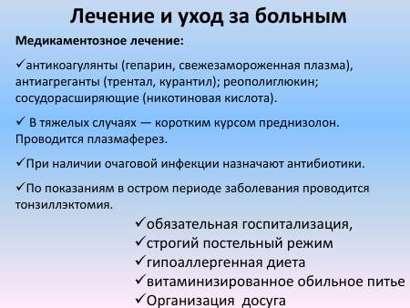{width=6cm}

**Лекарства:**

| Группа | Препараты | Зачем **(доп.)** |
|---|---|---|
| **Антикоагулянты** | **гепарин**, свежезамороженная плазма | против **микротромбов** |
| **Антиагреганты** | **трентал, курантил** | тромбоциты **не склеиваются** |
| Плазмозаменитель | **реополиглюкин** | кровь **жиже**, лучше микроциркуляция |
| Сосудорасширяющие | **никотиновая кислота** | |
| Гормоны | **преднизолон** (коротко, в тяжёлых случаях) | против воспаления |
| Другое | **плазмаферез**; **антибиотики** при очаге инфекции; **тонзиллэктомия** по показаниям | |

**Уход:** **обязательная госпитализация**, **строгий постельный режим**, **гипоаллергенная диета**, **обильное витаминизированное питьё**, **организация досуга**.

**Из лекции (подробнее):**

- через **2 недели после исчезновения сыпи** — полупостельный, потом общий режим;
- **убрать** из еды: продукты с непереносимостью, **облигатные аллергены**, **экстрактивные вещества**, **соленья, копчёности, жареное**; **меньше** животного белка, **больше** витаминов и **кальция**;
- **абдоминальная форма:** пища **жидкая или полужидкая**, **полуохлаждённая**, механически щадящая, **маленькими порциями**; **нельзя** чёрный хлеб, молоко, капусту, бобовые, газировку;
- на **гормонах** — продукты с **калием**.

- **Антикоагулянт** — средство против **свёртывания** крови. **(доп.)**
- **Антиагрегант** — не даёт тромбоцитам **склеиваться**. **(доп.)**
- **Свежезамороженная плазма** — плазма донора, замороженная сразу после взятия; в ней есть все факторы свёртывания. **(доп.)**
- **Плазмаферез** — кровь пропускают через аппарат и **убирают плазму с вредными комплексами**. **(доп.)**
- **Тонзиллэктомия** — **удаление миндалин** (хронический очаг инфекции). **(доп.)**
- **Облигатные аллергены** — продукты, которые **часто** вызывают аллергию: цитрусовые, шоколад, клубника, яйца, рыба, мёд, орехи. **(доп.)**
- **Экстрактивные вещества** — вещества из мяса и рыбы, которые переходят в **бульон**. **(доп.)**
- **Организация досуга** — игры, книги, рисование **в постели**, чтобы ребёнок **не вставал**. **(доп.)**
- **Медсестра при гепарине (доп.):** вводить **подкожно в живот**; следить за **кровотечениями** (дёсны, моча, стул); контроль **свёртываемости**.

### Слайд 19. Диспансерное наблюдение

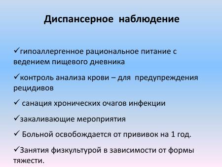{width=6cm}

- **гипоаллергенное** рациональное питание + **пищевой дневник**;
- **контроль анализа крови** — чтобы не было **рецидивов**;
- **санация** хронических очагов инфекции;
- **закаливание**;
- **освобождение от прививок на 1 год**;
- физкультура — **по тяжести** формы.

- **Пищевой дневник** — записывать, что ребёнок ел и была ли реакция. **(доп.)**
- **Рецидив** — болезнь вернулась. **(доп.)**
- **Санация** — лечение очага инфекции (кариес, тонзиллит). **(доп.)**
- **Закаливание** — постепенно приучать организм к холоду (водные процедуры, воздух). **(доп.)**
- **Почему нет прививок (доп.):** прививка может снова вызвать **сенсибилизацию** и рецидив.

---

# Часть 3. Тромбоцитопеническая пурпура (слайды 20–28)

### Слайд 20. Определение и причины

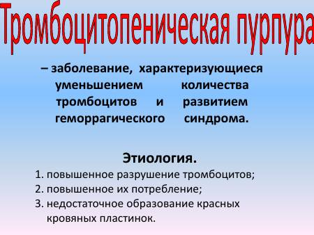{width=6cm}

**Тромбоцитопеническая пурпура** — заболевание, при котором **уменьшается количество тромбоцитов** и развивается **геморрагический синдром**.

**Этиология:**

1. **повышенное разрушение** тромбоцитов;
2. **повышенное потребление** (расход);
3. **недостаточное образование** «красных кровяных пластинок».

- **Тромбоцитопения** — **мало тромбоцитов**. **(доп.)**
- **Пурпура** — мелкие багровые кровоизлияния в кожу. **(доп.)**
- **Кровяные пластинки** — другое название **тромбоцитов** (они плоские). ⚠️ На слайде написано «красных» — тромбоциты **не красные**, это неточность. **(доп.)**
- Другое название — **болезнь Верльгофа**. **(доп.)**

**Из лекции:** формы **врождённые** и **приобретённые** (чаще). Приобретённые: **иммунные** (после вирусов или лекарств — антитела против своих тромбоцитов) и **неиммунные** (травма тромбоцитов при **гемангиоме** и большой селезёнке, угнетение костного мозга, расход при **ДВС**, дефицит витамина В и **фолиевой кислоты**). Бывает **тромбоцитопатия** — тромбоцитов хватает, но они **плохо работают**.

### Слайд 21. Этиология и патогенез (схема)

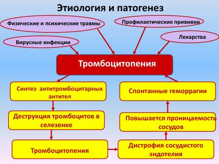{width=6cm}

**Что запускает (розовые овалы):** **вирусные инфекции**, **физические и психические травмы**, **профилактические прививки**, **лекарства**.

**Цепочка (жёлтые блоки):**

1. **синтез антитромбоцитарных антител** (организм делает антитела **против своих** тромбоцитов);
2. **разрушение тромбоцитов в селезёнке**;
3. **тромбоцитопения**;
4. **дистрофия сосудистого эндотелия** (стенка сосудов истончается — тромбоциты её больше «не кормят»);
5. **повышается проницаемость** сосудов;
6. **спонтанные геморрагии** (кровоизлияния сами по себе).

- **Деструкция** — разрушение. **(доп.)**
- **Дистрофия** — плохое питание ткани, она слабеет. **(доп.)**
- **Эндотелий** — внутренний слой стенки сосуда. **(доп.)**
- **Спонтанные** — без причины, сами по себе. **(доп.)**
- **Почему селезёнка (доп.):** она «фильтр» крови и **ловит** тромбоциты, покрытые антителами. Поэтому иногда её **удаляют** (спленэктомия).

### Слайд 22. Клинические проявления (рисунок)

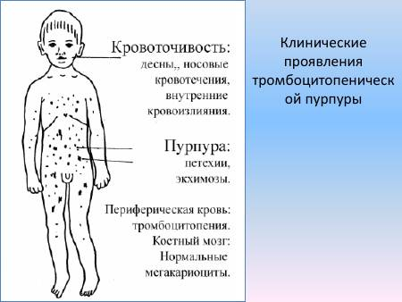{width=6cm}

| Что | Подробно |
|---|---|
| **Кровоточивость** | **дёсны, носовые кровотечения**, внутренние кровоизлияния |
| **Пурпура** | **петехии**, **экхимозы** |
| **Периферическая кровь** | **тромбоцитопения** |
| **Костный мозг** | **нормальные мегакариоциты** |

- **Петехии** — **мелкие точки**-кровоизлияния (как укол иголки). **(доп.)**
- **Экхимозы** — **большие синяки**. **(доп.)**
- **Мегакариоциты** — большие клетки **костного мозга**, от которых «отрываются» тромбоциты. **(доп.)**
- **Почему мегакариоциты в норме (доп.):** костный мозг **делает** тромбоциты нормально, но они **быстро разрушаются** в селезёнке.

### Слайд 23. Где сыпь при ТП (рисунок)

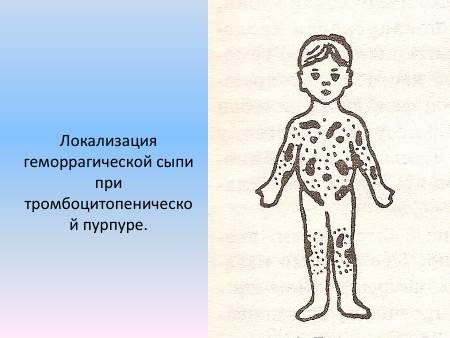{width=6cm}

Пятна **разного размера** — **везде**: **грудь, живот, руки, ноги**, лицо; **беспорядочно**, **несимметрично**.

**Сравните со слайдом 10 (васкулит):** там сыпь только на **ногах, ягодицах, разгибательной поверхности рук** и **симметричная**.

### Слайд 24. Фото: сыпь при ТП

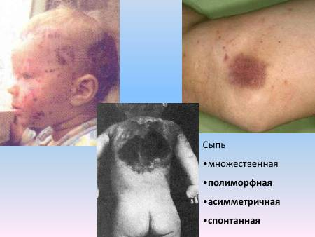{width=6cm}

Сыпь:

- **множественная** — много элементов;
- **полиморфная** — **разная**: точки и большие синяки вместе;
- **асимметричная**;
- **спонтанная** — появляется сама.

**Если спросят «что вы видите?»:** «Слева — ребёнок с **петехиями** и синяками на **лице**; в центре — **огромный экхимоз** на спине; справа — большой синяк на коже. Сыпь множественная, полиморфная, несимметричная — **тромбоцитопеническая пурпура**».

**Из лекции:** **неадекватность** травмы и кровоизлияния — **маленький удар → огромный синяк**.

### Слайд 25. Симптом «шкуры леопарда»

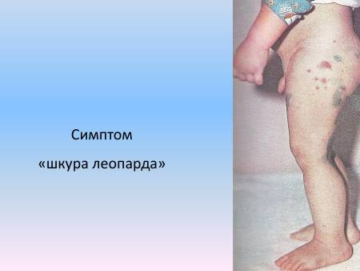{width=6cm}

Синяки **разного цвета** на одном ребёнке, потому что появились **в разное время**: **багрово-красный** (свежий) → **синий** → **зеленоватый** → **жёлтый** (старый). Кожа пятнистая, как у **леопарда**.

**Если спросят:** «На ноге — синяки разного цвета: свежие красные, синие, зелёные и жёлтые. Это **симптом „шкуры леопарда"**».

### Слайд 26. Фото: носовое кровотечение

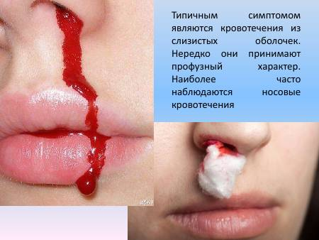{width=6cm}

**Типичный симптом** — кровотечения **из слизистых**. Часто **профузные**. **Чаще всего — носовые.**

**Из лекции:** ещё кровоточат **дёсны**, **лунка удалённого зуба**, язык, миндалины; реже — **гематурия** и кровотечение из ЖКТ; у девочек-подростков — **тяжёлые мено- и метроррагии**. В тяжёлых случаях — кровоизлияния **в мозг**, глазное дно, сетчатку. **Печень и селезёнка не увеличены.** Положительные пробы **жгута и щипка**.

- **Профузный** — очень обильный. **(доп.)**
- **Гематурия** — кровь в моче. **(доп.)**
- **Менорагия** — обильные месячные; **метроррагия** — кровотечение из матки **между** месячными. **(доп.)**
- **Проба жгута** — манжету тонометра накладывают на плечо на 5 минут; ниже появляются **петехии** → проба положительная. **(доп.)**
- **Проба щипка** — щипок кожи под ключицей → появляется **синяк**. **(доп.)**
- **На правом фото** — **ватный тампон** в носу: так останавливают кровотечение (см. часть 6).

### Слайд 27. Лабораторная диагностика

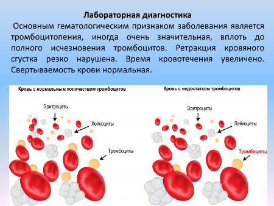{width=6cm}

- **тромбоцитопения** — главный признак, иногда тромбоцитов **почти нет**;
- **ретракция сгустка резко нарушена**;
- **время кровотечения увеличено**;
- **свёртываемость крови нормальная**.

**На рисунке:** слева — кровь с **нормальным** количеством тромбоцитов (жёлтые кружки); справа — тромбоцитов **очень мало**.

- **Ретракция сгустка** — сгусток **сжимается** и становится плотным; это делают **тромбоциты**. Нет тромбоцитов → сгусток **рыхлый**. **(доп.)**
- **Время кровотечения** — сколько кровь идёт из маленького прокола пальца или мочки уха (метод **Дуке**): норма **2–4 минуты**. **(доп.)**
- **Время свёртывания** — за сколько кровь свернётся **в пробирке**. При ТП — **норма** (факторы плазмы в порядке). **(доп.)**
- **Норма тромбоцитов:** 200–300·10⁹/л; опасно **ниже 20–30·10⁹/л**. **(доп.)**

### Слайд 28. Лечение

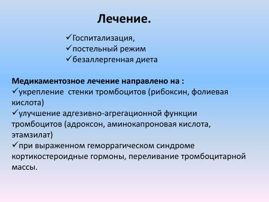{width=6cm}

**Госпитализация**, **постельный режим**, **безаллергенная диета**.

**Лекарства направлены на:**

- **укрепление стенки тромбоцитов**: **рибоксин, фолиевая кислота**;
- **улучшение адгезивно-агрегационной функции** тромбоцитов: **адроксон, аминокапроновая кислота, этамзилат**;
- при **выраженном** геморрагическом синдроме — **кортикостероидные гормоны**, **переливание тромбоцитарной массы**.

**Из лекции:** иммунная форма — гормоны и **иммуноглобулин**; нет эффекта 3–4 месяца → **спленэктомия**; местно — **гемостатическая губка**, тромбин; **травы**: тысячелистник, пастушья сумка, крапива, шиповник; **арахис**.

- **Адгезия** — тромбоциты **прилипают к стенке** сосуда; **агрегация** — **склеиваются между собой**. **(доп.)**
- **Резистентность** — устойчивость. **(доп.)**
- **Этамзилат** = **дицинон**: укрепляет сосуды и помогает тромбоцитам. **(доп.)**
- **Аминокапроновая кислота** — не даёт сгустку **раствориться**. **(доп.)**
- **Тромбоцитарная масса** — тромбоциты донора для переливания. **(доп.)**
- **Спленэктомия** — удаление селезёнки. **(доп.)**
- **❌ Нельзя (доп.):** **аспирин** и **анальгин** — мешают тромбоцитам; **в/м уколы** — будут гематомы.

---

# Часть 4. Гемофилия (слайды 29–45)

### Слайд 29. Гемофилия: определение, виды, степени

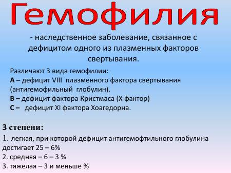{width=6cm}

**Гемофилия** — **наследственное** заболевание с **дефицитом одного из плазменных факторов свёртывания**.

| Вид | Дефицит |
|---|---|
| **А** | **VIII** фактора (антигемофильный глобулин) |
| **В** | фактора **Кристмаса** (на слайде «X» — ⚠️ ошибка, правильно **IX**, см. слайд 30) |
| **С** | **XI** фактора (на слайде «Хоагедорна» — ⚠️ правильно **Розенталя**, см. слайд 30) |

**3 степени (по слайду):** лёгкая — 25–6 %, средняя — 6–3 %, тяжёлая — 3 % и меньше.

- **Фактор свёртывания** — белок плазмы для сгустка. Их 13, номера I–XIII. **(доп.)**
- **% фактора** — сколько фактора работает. Норма — **50–150 %**. **Чем меньше %, тем тяжелее.** **(доп.)**
- **Глобулин** — вид белка. **(доп.)**
- «Гемофилия» = «любовь к крови» (по-гречески). **(доп.)**
- ⚠️ В учебниках степени чаще такие: лёгкая > 5 %, средняя 1–5 %, тяжёлая < 1 %. На занятии говорите **как на слайде**. **(доп.)**

### Слайд 30. Виды гемофилий (подробно)

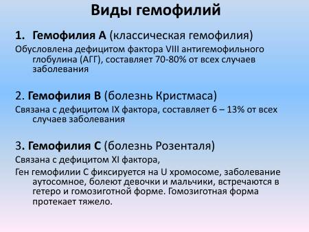{width=6cm}

| Вид | Фактор | Частота | Особенности |
|---|---|---|---|
| **А — классическая** | **VIII** (АГГ) | **70–80 %** | болеют мальчики |
| **В — болезнь Кристмаса** | **IX** | **6–13 %** | болеют мальчики |
| **С — болезнь Розенталя** | **XI** | редко | **аутосомная**: болеют **и девочки, и мальчики**; гетеро- и гомозиготная формы; **гомозиготная — тяжелее** |

**Этот слайд правильнее**, чем слайд 29: В — **IX**, С — **Розенталь**.

- **АГГ** — антигемофильный глобулин (= фактор VIII). **(доп.)**
- **Аутосомная** — ген лежит **не на половой хромосоме**, поэтому болеют **оба пола**. **(доп.)**
- **Гетерозиготная** — больной ген **от одного** родителя (легче); **гомозиготная** — **от обоих** (тяжелее). **(доп.)**
- ⚠️ На слайде «ген на U хромосоме» — опечатка/неточность: гемофилия С **аутосомная**, ген на **4-й** хромосоме. **(доп.)**

### Слайд 31. Фото: тромб

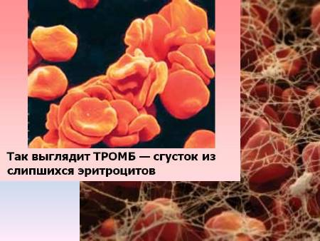{width=6cm}

«Так выглядит **тромб** — сгусток из **слипшихся эритроцитов**». Справа видна **сеть из нитей фибрина**.

**Своими словами (доп.):** при гемофилии **нет нужного фактора** → **сеть фибрина не образуется** → сгусток слабый, кровь течёт снова.

### Слайд 32. Как наследуется гемофилия (схема)

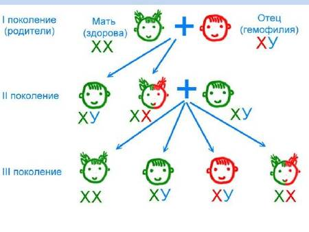{width=6cm}

**Красная Х** — Х-хромосома **с геном гемофилии**.

| Поколение | Кто | Что получилось |
|---|---|---|
| **I** | **мать здорова** (XX) + **отец болен** (**X**Y) | |
| **II** | **сын** XY | **здоров** (от отца получил Y, а не больную X) |
| **II** | **дочь** X**X** | **носитель** (одна X от отца больная, но вторая здоровая её заменяет) |
| **III** (дочь-носитель + здоровый мужчина) | дочь XX | **здорова** |
| | сын XY | **здоров** |
| | сын **X**Y | **болен** |
| | дочь X**X** | **носитель** |

**Правила (доп.):**

- **больной отец** → **все дочери — носители**, **все сыновья здоровы**;
- **мать-носитель** → **50 % сыновей больны**, **50 % дочерей — носители**;
- **мальчик болеет**, потому что у него **одна** X, заменить нечем.

- **Рецессивный** — признак проявляется, только если **нет здорового гена** рядом. **(доп.)**
- **Сцеплённый с Х-хромосомой** — ген лежит на **Х-хромосоме**. **(доп.)**
- **Носитель** — человек **здоров**, но **передаёт** ген детям. **(доп.)**
- ⚠️ На схеме «У» написано русской буквой; правильно — латинская **Y** (игрек). **(доп.)**

### Слайд 33. Клинические проявления (фото)

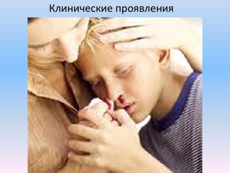{width=6cm}

**Если спросят «что вы видите?»:** «Мальчик с **носовым кровотечением**, мама **прижимает** нос салфеткой. При гемофилии кровотечения из **носа, дёсен, рта**».

**Из лекции — главное:**

- **длительные** кровотечения и **массивные** кровоизлияния: в подкожную клетчатку, **мышцы, суставы**, внутренние органы;
- **отсроченные**: начинаются **через несколько часов**, иногда **на 2-е сутки** после травмы;
- **обильнее**, чем должно быть при такой травме; бывают **спонтанные**;
- **периодически повторяются**.

- **Отсроченный (доп.):** сначала кровь **останавливается** (тромбоциты в **норме**, делают пробку), но **без фибрина** пробка слабая → через часы кровотечение **снова**.

### Слайд 34. Фото: гематомы

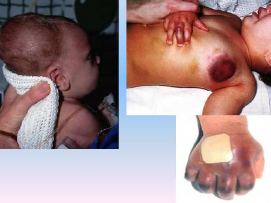{width=6cm}

**Если спросят:**

- слева — **новорождённый** с большой **гематомой на голове** (**кефалогематома**);
- справа вверху — **огромная гематома** на плече и груди у малыша;
- справа внизу — **кисть**: отёк и синяки после **укола** (пластырь) → поэтому при гемофилии **нельзя в/м и п/к уколы**.

**Из лекции:** у **новорождённых** — **кефалогематомы**, **внутричерепные** кровоизлияния, кровотечение из **пупочной ранки** и кишечника; у большинства — когда **начинают ползать и ходить**.

- **Гематома** — большое скопление крови под кожей или в мышце. **(доп.)**
- **Кефалогематома** — кровоизлияние **под надкостницу** черепа у новорождённого (мягкая шишка). **(доп.)**
- **Пупочная культя** — остаток пуповины после рождения. **(доп.)**

### Слайды 35–37. Фото: гемартрозы и гематомы

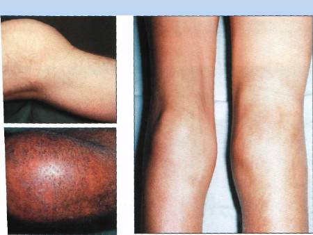{width=6cm} 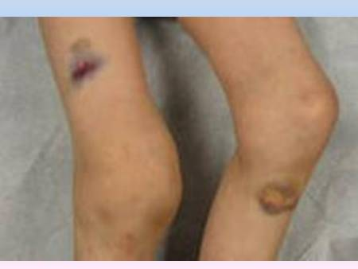{width=6cm} 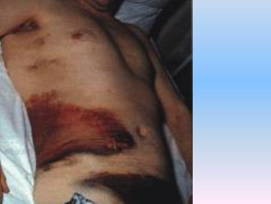{width=6cm}

**Если спросят:**

- **слайд 35** — **колени** увеличены, округлые, с покраснением кожи — **гемартроз**; справа — колени **разной формы** (одно деформировано после повторных кровоизлияний);
- **слайд 36** — колени **увеличены**, на голени — синяки и ссадина;
- **слайд 37** — **огромная гематома** на боку и животе.

**Из лекции:** кровоизлияния в **крупные суставы** — **самый типичный** признак. Сустав **быстро увеличивается**. В первые разы кровь **рассасывается**; **повторно** в тот же сустав → **разрушение**, воспаление → **анкилоз**.

- **Гемартроз** — кровь **в полости сустава**. **(доп.)**
- **Анкилоз** — сустав **срастается** и **не двигается**. **(доп.)**
- **Деструктивные изменения** — разрушение. **(доп.)**
- **Признаки гемартроза (доп.):** сустав **опух**, горячий, **сильная боль**, ребёнок держит ногу **согнутой** и не даёт двигать.

### Слайд 38. Кровоизлияние в сустав — что делать

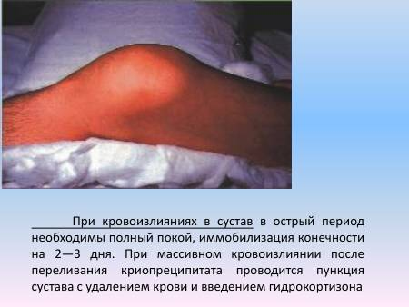{width=6cm}

В **острый период**: **полный покой**, **иммобилизация** конечности на **2–3 дня**.
При **массивном** кровоизлиянии: **после** переливания **криопреципитата** — **пункция сустава**: убрать кровь и ввести **гидрокортизон**.

- **Иммобилизация** — обездвиживание (лонгета, шина). **(доп.)**
- **Пункция сустава** — прокол сустава иглой. **(доп.)**
- **Почему сначала криопреципитат (доп.):** без фактора прокол сам вызовет **новое кровотечение**.
- **Ещё (доп.):** **холод** через ткань, **возвышенное** положение конечности.
- **Гидрокортизон** — гормон против воспаления. **(доп.)**

### Слайд 39. Лечение гемартрозов потом

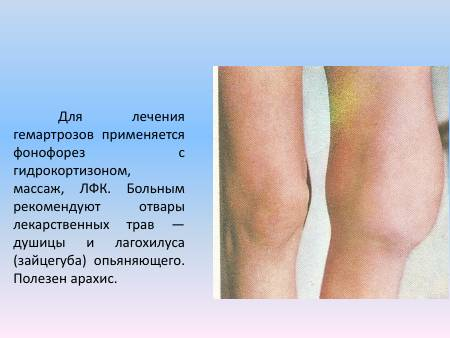{width=6cm}

**Фонофорез с гидрокортизоном**, **массаж**, **ЛФК**. Травы: **душица**, **лагохилус (зайцегуб) опьяняющий**. Полезен **арахис**.

- **Фонофорез** — лекарство вводят через кожу **ультразвуком**. **(доп.)**
- **ЛФК** — лечебная физкультура: чтобы сустав **не застыл**. **(доп.)**
- **Лагохилус** — растение, которое **помогает свёртыванию** крови. **(доп.)**
- **На фото** — колени **разного размера**, на одном — жёлтый след старого кровоизлияния.

### Слайд 40. Фото из учебника: гемартрозы колен и стопы

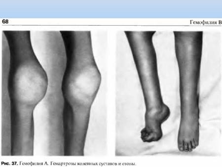{width=6cm}

«Рис. 37. **Гемофилия А.** Гемартрозы коленных суставов и стопы».
**Ответ:** «Колени **увеличены**, шаровидные — гемартрозы; справа — **стопа деформирована**, в вынужденном положении (**контрактура**) после повторных кровоизлияний».

- **Контрактура** — сустав **не разгибается** до конца. **(доп.)**
- ⚠️ Вверху страницы написано «Гемофилия В» — это заголовок страницы книги; подпись под рисунком — «**Гемофилия А**».

### Слайд 41. Лечение гемофилии

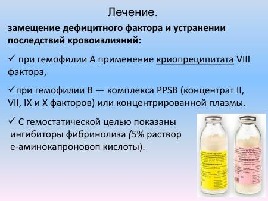{width=6cm}

**Главное: заместить недостающий фактор и убрать последствия кровоизлияний.**

| Вид | Чем лечат |
|---|---|
| **Гемофилия А** | **криопреципитат VIII фактора** |
| **Гемофилия В** | **комплекс PPSB** (концентрат **II, VII, IX и X** факторов) или концентрированная плазма |
| Для остановки кровотечения | **ингибиторы фибринолиза**: **5 % аминокапроновая кислота** |

**Из лекции:** вводят **в/в струйно**, **сразу после размораживания**. Местно: **фибриновая плёнка, гемостатическая губка, тромбин, грудное молоко**.

- **Заместительная терапия** — даём то, чего **не хватает**. **(доп.)**
- **Криопреципитат** — концентрат факторов свёртывания из **замороженной** плазмы донора. **(доп.)**
- **PPSB** — по первым буквам факторов: **P**ротромбин (II), **P**роконвертин (VII), **S**tuart (X), **B** — антигемофильный глобулин **B** (IX). **(доп.)**
- **Фибринолиз** — растворение сгустка; **ингибитор** не даёт ему раствориться. **(доп.)**
- **Почему сразу после размораживания (доп.):** факторы **быстро разрушаются** при комнатной температуре.
- ⚠️ На слайде опечатка: «аминокапроновоп» → **аминокапроновой**.

### Слайд 42. Фото: пакеты с криопреципитатом

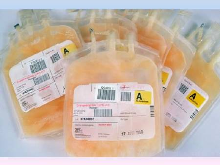{width=6cm}

Пакеты **Cryoprecipitate** с указанной **группой крови** (A, Rh-positive).
**Медсестра (доп.):** перед переливанием проверить **группу крови и резус**, срок годности, целостность пакета; разморозить по правилам; вводить **сразу**; наблюдать за **аллергией**.

### Слайд 43. Домашнее лечение

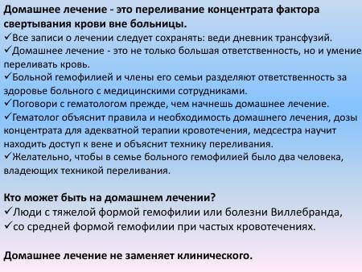{width=6cm}

**Домашнее лечение** — **переливание концентрата фактора дома**, вне больницы.

- вести **дневник трансфузий**;
- это **ответственность** и **умение** переливать;
- больной и семья **делят ответственность** с медиками;
- **сначала поговорить с гематологом**: он объяснит правила и **дозы**, а **медсестра научит** находить **вену** и **технике** переливания;
- лучше, если в семье **двое** умеют переливать.

**Кому можно:** **тяжёлая** форма гемофилии или **болезнь Виллебранда**; **средняя** форма при **частых** кровотечениях.
**Домашнее лечение не заменяет клинического** (больницы).

- **Трансфузия** — переливание. **(доп.)**
- **Концентрат фактора** — современный препарат фактора VIII (порошок + растворитель); удобнее криопреципитата. **(доп.)**
- **Гематолог** — врач по болезням крови. **(доп.)**
- **Болезнь Виллебранда** — тоже наследственная кровоточивость, нет **фактора Виллебранда** (он помогает тромбоцитам прилипать); болеют **и девочки, и мальчики**. **(доп.)**
- **Роль медсестры здесь** — **обучать** семью: вена, техника, дневник. **(доп.)**

### Слайд 44. Уход

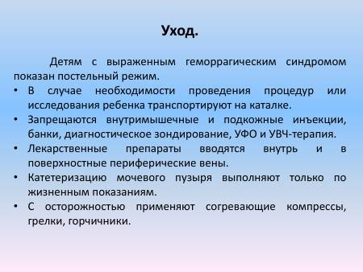{width=6cm}

- при выраженном геморрагическом синдроме — **постельный режим**;
- на процедуры — **на каталке**;
- **❌ запрещены**: **в/м и п/к инъекции**, **банки**, **диагностическое зондирование**, **УФО** и **УВЧ**;
- лекарства — **внутрь** и в **поверхностные периферические вены**;
- **катетеризация мочевого пузыря** — только по **жизненным показаниям**;
- **осторожно**: согревающие компрессы, грелки, горчичники.

**Из лекции — антитравматический режим:** спокойные игры; сопровождение на прогулках; не ходить по **мокрому полу**; убрать **острые** предметы; одежда **без грубых швов и тугих резинок**; ❌ спорт с прыжками, ударами, **велосипед**; ✅ **плавание**; **поролоновые щитки** на суставы; развивать интерес к **чтению**.
**Профилактика:** **медико-генетическое консультирование**; при беременности — **УЗИ** для определения **пола**.

- **Банки** — стеклянные банки на спине (вакуум) → **синяки**. **(доп.)**
- **Зондирование** — введение зонда (в желудок и др.) → может поранить слизистую. **(доп.)**
- **УФО** — ультрафиолет; **УВЧ** — прогревание током: **усиливают кровоток** → кровотечение. **(доп.)**
- **Жизненные показания** — без этого человек может **умереть**. **(доп.)**
- **Поверхностные вены** — видны под кожей, их легко **прижать** после укола. **(доп.)**
- **Почему грелки осторожно (доп.):** тепло **расширяет сосуды** → больше кровотечение.
- **Медико-генетическое консультирование** — врач-генетик объясняет семье **риск** рождения больного ребёнка. **(доп.)**

### Слайд 45. Школа гемофилии

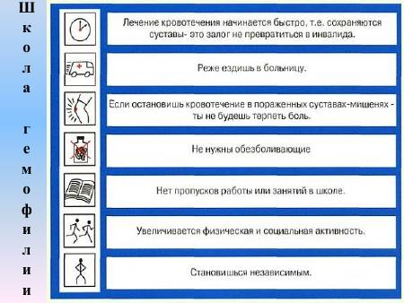{width=6cm}

Почему важно **лечить кровотечение быстро** (дома, сразу):

- **суставы сохраняются** → ребёнок **не станет инвалидом**;
- **реже** ездить в больницу;
- в **суставах-мишенях** не будет **боли**;
- **не нужны обезболивающие**;
- **нет пропусков** школы и работы;
- больше **физической и социальной** активности;
- ребёнок становится **независимым**.

- **Школа гемофилии** — занятия для детей и родителей: как жить с гемофилией. **(доп.)**
- **Сустав-мишень** — сустав, в который кровь попадает **снова и снова**. **(доп.)**
- **Инвалид** — человек с серьёзным ограничением здоровья. **(доп.)**

### Слайд 46. Литература

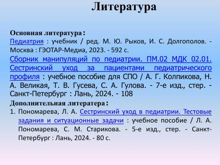{width=6cm}

Учебник «Педиатрия» (Рыков, Долгополов, 2023); «Сборник манипуляций по педиатрии» (Колпикова и др., 2024); Пономарёва «Тестовые задания и ситуационные задачи» (2024).

---

# Часть 5. Методичка (тема № 13): тесты и задачи

### Тесты — ответы

В методичке правильные ответы **не отмечены**. Мои ответы по лекции:

| № | Вопрос | Ответ |
|---|---|---|
| 1 | Симметричная пятнисто-папулёзная сыпь типична для… | **геморрагического васкулита** |
| 2 | Повторяющаяся кровоточивость у **мальчиков** после травмы — … | **гемофилия** |
| 3 | Для ТП типичны… | **носовые кровотечения** |
| 4 | Для гемостаза при гемофилии А в/в вводят… | **криопреципитат** |
| 5 | Гемофилия А — недостаток фактора… | **восьмого (VIII)** |

### Ситуационные задачи — кратко

**Задача 1. Серёжа, 12 лет, гемофилия, гематома на спине** (Hb 70 г/л).

- Потребности: **двигаться, отдыхать, быть здоровым**.
- Проблемы: настоящие — **нарастающая гематома**, тугоподвижность коленей, **постгеморрагическая анемия**; потенциальные — **геморрагический шок**, **анкилоз**, инфицирование гематомы. **Приоритетная — нарастающая гематома.**
- Цели: кровотечение остановится **через 30 минут**; семья будет знать профилактику и первую помощь.
- Медсестра: **покой**; **тугая повязка и холод** на гематому; назначения врача; беседа о **травматизме**; досуг; наблюдение (**цвет кожи, АД, пульс, ЧДД**); проветривание 3–4 раза в день; настои **водяного перца, календулы**; гигиена.

**Задача 2. Мальчик 10 лет, ТП, носовое кровотечение во время игры.**

- Потребности: **есть, пить, дышать, быть здоровым**.
- Проблемы: **носовое кровотечение** (приоритетная), беспокойство, кровоизлияния на коже.
- Цели: остановить кровотечение **за 3 минуты**; родные научатся останавливать его **дома**.

**Задача 3. Ребёнок 5 лет, васкулит, кожно-абдоминально-почечная форма** (после гамма-глобулина).

- Признаки: сильная боль в животе, рвота с кровью, **мелена**, моча цвета **«мясных помоев»** (кровь в моче), симметричная сыпь на голенях, t 37,8 °C.
- Потребности: есть, пить, **выделять**, поддерживать температуру, быть здоровым, чистым, в безопасности.
- Цель: **боли в животе и кишечное кровотечение уменьшатся к концу смены**.

**Задача 4. Боря, 7 лет, гемофилия, порезал палец 2 дня назад, кровь не останавливается.**

- Потребности: **быть чистым, быть в безопасности**.
- Проблема: настоящая — **длительное кровотечение**; потенциальная — **геморрагический шок**.
- ⚠️ В эталоне написано «носовое кровотечение», хотя в задаче — **порез пальца**. Это ошибка копирования. Отвечайте: **длительное кровотечение из пореза**.

**Задача 5. Девочка 6 лет, ТП, синяки после художественной гимнастики, ухудшение после ОРВИ.**

- Потребности: **двигаться, общаться, играть**.
- Проблемы: слабость, тревожность, плохой аппетит, **спонтанные кровоподтёки**; потенциальные — **носовые и другие кровотечения**.
- Цели: к концу недели **меньше** кровоизлияний; к выписке семья знает **профилактику обострений**.

**«Моча цвета мясных помоев» (доп.)** — мутная **красно-бурая** моча, как вода после мытья мяса: признак **крови в моче** (поражение почек).
**Геморрагический шок (доп.)** — опасное состояние после **большой потери крови**: бледность, холодный пот, частый слабый пульс, низкое АД.

---

# Часть 6. 🚨 Носовое кровотечение — первая помощь (доп.)

Самая частая неотложка при всех трёх болезнях.

1. **Успокоить**, **посадить**, голову **слегка наклонить вперёд**. ❌ **Не запрокидывать назад** (кровь пойдёт в горло → рвота).
2. **Прижать крылья носа** к перегородке на **10 минут**.
3. **Холод на переносицу** (через ткань).
4. Не остановилось → **ватный тампон** с **3 % перекисью водорода** или **гемостатическая губка** / аминокапроновая кислота в нос.
5. **Вызвать врача.** При гемофилии врач вводит **фактор**, при ТП — гемостатики.
6. Наблюдать: **пульс, АД, бледность**, сколько крови.

---

# Словарь трудных слов

| Слово | Простое объяснение |
|---|---|
| Абдоминальный | связанный с животом |
| Агрегация | склеивание тромбоцитов между собой |
| Адгезия | прилипание тромбоцитов к стенке сосуда |
| Анкилоз | сросшийся, неподвижный сустав |
| Антиагрегант | лекарство, чтобы тромбоциты не склеивались |
| Антикоагулянт | лекарство против свёртывания крови |
| Аутосомный | ген не на половой хромосоме, болеют оба пола |
| Вазопатия | болезнь сосудов |
| Васкулит | воспаление сосудов |
| Гематома | большой синяк, кровь под кожей или в мышце |
| Гематурия | кровь в моче |
| Гемартроз | кровь в полости сустава |
| Гемостаз | остановка кровотечения |
| Гиперемия | покраснение |
| ДВС-синдром | много мелких тромбов, потом сильные кровотечения |
| Иммобилизация | обездвиживание |
| Кефалогематома | кровь под надкостницей черепа у новорождённого |
| Коагулограмма | анализ свёртывания крови |
| Криопреципитат | концентрат факторов свёртывания из замороженной плазмы |
| Мегакариоцит | клетка костного мозга, из которой образуются тромбоциты |
| Мелена | чёрный дёгтеобразный стул (кровь из ЖКТ) |
| Микротромб | маленький сгусток в мелком сосуде |
| Носитель | здоровый человек, который передаёт ген болезни |
| Папула | бугорок над кожей |
| Петехии | точечные кровоизлияния |
| Пигментация | коричневое пятно после сыпи |
| Плазмаферез | очистка плазмы крови аппаратом |
| Полиморфный | разный по виду |
| Профузный | очень обильный |
| Пурпура | мелкие багровые кровоизлияния в кожу |
| Ретракция сгустка | сжатие сгустка (делают тромбоциты) |
| Рецессивный | проявляется, только если нет здорового гена |
| Сенсибилизация | повышенная чувствительность организма |
| Спленэктомия | удаление селезёнки |
| Спонтанный | сам по себе, без причины |
| Тенезмы | ложные болезненные позывы в туалет |
| Тонзиллэктомия | удаление миндалин |
| Тромбоцитопения | мало тромбоцитов |
| Тромбоцитоз | много тромбоцитов |
| Тромбоцитопатия | тромбоциты есть, но плохо работают |
| Фибриноген / фибрин | белок плазмы / нити сгустка |
| Фибринолиз | растворение сгустка |
| Фонофорез | введение лекарства через кожу ультразвуком |
| Экхимоз | большой синяк |
| Эндотелий | внутренний слой стенки сосуда |
| Эозинофилия | много эозинофилов (аллергия) |
